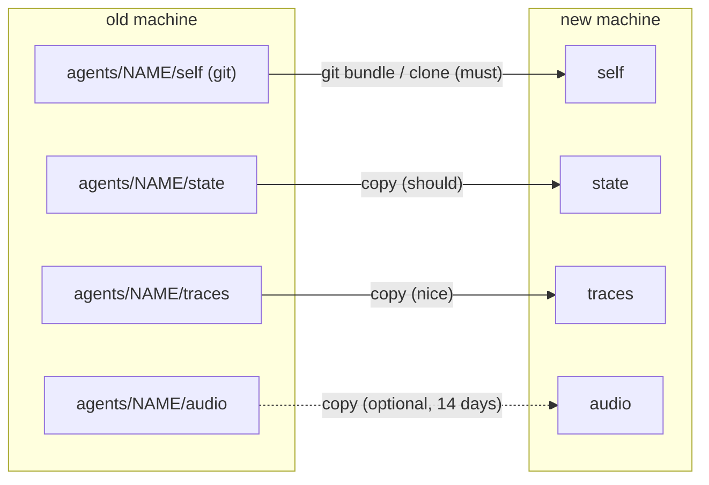
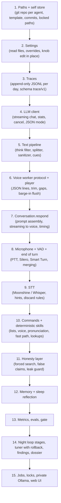

# Rebuilding IRIS

Three situations, from the most common to the most thorough:

1. [Same code, new machine](#1-same-code-new-machine): install and restore.
2. [Moving an agent](#moving-an-agent-persona-memory-settings): persona, memory, settings, history.
3. [Re-implementing from zero](#3-re-implementing-from-zero): what to build, in what order, with which
   contracts and numbers, if the code itself can't be reused.

On a variant branch, read that branch's `docs/variants/NAME/README.md` first: it says what differs.

---

## 1. Same code, new machine

### Prerequisites

| Need | Why | Arch / Omarchy |
|---|---|---|
| NVIDIA driver with CUDA 12 support | Ollama, Kokoro, GPU Whisper | `nvidia` / `nvidia-open` driver |
| Ollama from the **official script** | ships CUDA 12 runners that still support Pascal (sm_61); distro builds may be CUDA 13 only | `curl -fsSL https://ollama.com/install.sh \| sh` |
| PortAudio, libsndfile | microphone and speaker, WAV files | `sudo pacman -S --needed portaudio libsndfile` |
| espeak-ng | Kokoro's fallback phonemizer | `sudo pacman -S --needed espeak-ng` |
| git, Python 3.11 via `uv` | everything | `setup.sh` installs `uv` for the user if missing |
| systemd user session | IRIS's Ollama unit, optional timers | standard |

Other GPUs: anything Ollama and torch support works; check the VRAM budget in
[architecture/00](architecture/00-overview.md#4-hardware-budget-the-machine-it-was-built-for).
No GPU: everything runs on the CPU, slowly (set `tts.kokoro.device: cpu`, a CPU recogniser such as
`moonshine/base`, a small LLM).

### Install

```bash
git clone https://github.com/tronnyg/the-iris-system.git ~/the-iris-system
cd ~/the-iris-system
./setup.sh                 # idempotent; re-run until no [fail] lines. Logs: logs/setup.log
# or unattended, including one night run:  nohup ./tonight.sh > logs/tonight.log 2>&1 &
```

`setup.sh` creates `.venvs/core` (faster-whisper, Moonshine, fastembed, ddgs, sounddevice),
`.venvs/kokoro` and `.venvs/chatterbox` (torch cu126 wheels, which include Pascal kernels), writes the
`~/.local/bin/iris` launcher, runs `iris init`, and downloads the models.

### Models

| Model | How | Size | Used for |
|---|---|---|---|
| daytime LLM, e.g. `gemma4:e4b-it-qat` (template default `qwen3:4b`) | `ollama pull …` | 3–7 GB | conversation |
| judge `qwen3:8b` | `ollama pull qwen3:8b` | ~5 GB | night judge and prompt proposals |
| Whisper `base.en`, `small.en`, `large-v3-turbo` | `setup.sh` (faster-whisper download) | 0.1–1.6 GB | recogniser, teacher |
| Moonshine base | first use (Hugging Face) | ~0.4 GB | fast CPU recogniser |
| Kokoro-82M + spaCy `en_core_web_sm` | `setup.sh` | ~0.4 GB | voice |
| Chatterbox turbo | `setup.sh` (optional) | ~3 GB | expressive voice |
| Smart Turn v3.2 | first hands-free session | 8 MB | end of turn |
| BAAI/bge-small-en-v1.5 | first session (fastembed) | ~130 MB | semantic recall |

`large-v3-turbo@gpu` needs no extra install: it borrows CUDA 12 cuBLAS/cuDNN from `.venvs/kokoro`.

### Restore an agent and verify

```bash
# restore (see the next section for what to copy)
iris doctor                                   # every FAIL line says what to fix
.venvs/core/bin/python -m pytest -q           # hermetic, ~30 s
iris talk --ui                                # talk
iris jobs enable                              # only if you want the nightly/idle timers
```

---

## Moving an agent (persona, memory, settings)

An agent is one folder: `~/.local/share/iris/agents/NAME/`. Everything that makes it *itself* is in
`self/`, a git repository.



### Whole agent

```bash
# old machine
cd ~/.local/share/iris/agents
tar czf ~/iris-agent-iris.tgz --exclude='audio' iris        # add audio if you want it
# new machine (after setup.sh)
mkdir -p ~/.local/share/iris/agents && tar xzf ~/iris-agent-iris.tgz -C ~/.local/share/iris/agents
```

Self store only, with its full history:

```bash
git -C ~/.local/share/iris/agents/iris/self bundle create ~/iris-self.bundle --all
# new machine
git clone ~/iris-self.bundle ~/.local/share/iris/agents/iris/self
```

### Only some parts, into another agent

| Part | Files | How |
|---|---|---|
| persona | `self/persona/NAME.yaml` | `iris --agent other persona add NAME --file NAME.yaml`, then `persona use NAME` |
| facts about you | `self/memory/user.md` | copy the `- ` lines into the other agent's file (plain markdown) |
| behaviour lessons | `self/memory/lessons.md` | same |
| past conversations | `self/memory/episodes/*.md` | copy the files |
| pronunciations | `self/pods/voice/pronunciations.yaml` (`entries`, `respell`) | merge the maps |
| voice and other settings | `self/pods/voice/pod.yaml` | copy individual `value:`s with `iris set knob|model …` |
| your evals | `self/evals/golden/` | copy (locked: commit it yourself in that self store) |
| your lists | `state/lists.jsonl` | copy the lines |

Commit what you copied into the target self store (`git -C …/self add -A && git commit -m "imported …"`)
so it is part of its history.

### After moving to different hardware

* `state/vram.json` and `state/model_traits.json` describe the old machine: delete them (they are
  re-learned).
* `audio.input_device`, `tts.*.device` and `models.stt` (`@gpu` or not) may need changing.
* `models.llm` must be pulled on the new machine (`ollama pull …`).
* Run `iris night` once: it re-grades recognisers and voices, benchmarks models and re-tunes knobs
  against the same evals and history.

---

## 3. Re-implementing from zero

Use this if the code itself can't be reused (another language, another OS). The **contracts** below
are what the rest of the system relies on; the **numbers** are measured values worth keeping.

### Build order



At every step, port the matching tests from `tests/` (they are behaviour specifications written in
plain Python); `tests/test_session_replay.py` holds the real phrases that once failed.

### Contracts to keep

| Contract | Defined in | Shape |
|---|---|---|
| Self store layout | [architecture/07](architecture/07-self-store.md) | the files and their meaning; one git commit per change; `[auto]` prefix for automatic ones |
| pod.yaml knob entry | [architecture/13](architecture/13-configuration-reference.md) | `name: {value, min, max, step, tier}` on one line |
| Trace record | [architecture/11](architecture/11-observability.md) | one JSON object per line, `schema: trace/v1` |
| TTS worker | [architecture/04](architecture/04-speaking.md#6-tts-workers) | stdin/stdout JSON lines: `load`, `synth` (audio as a .npy path), `ping`, `quit` |
| Engine | same | `name`, `sr`, `load(options)`, `synth(text, speed, opts) -> float32 mono` |
| Tool | [architecture/03](architecture/03-thinking.md#4-tools) | name, description, JSON-schema parameters, `run(args) -> text`, optional text form `<<name: ARG>>` |
| Eval case | [architecture/08](architecture/08-learning-loops.md#5-evals-and-the-no-regression-gate) | `{id, user, history?, checks}` |
| Finding | [architecture/08](architecture/08-learning-loops.md#7-findings) | `{id, area, kind, title, evidence[], source, confidence, count, status, fingerprint}` |
| Web events | [architecture/10](architecture/10-web-ui.md#4-events-session--page) | SSE `data: {type, t, …}` |

### Numbers worth keeping (measured on the original hardware)

| What | Value | Source |
|---|---|---|
| Smart Turn: first check / later checks | P ≥ 0.5 after 250 ms, then P ≥ 0.8 every 400 ms; give up at 2 s | [ADR-0012](adr/0012-turn-taking-silero-smart-turn.md) |
| extra hold | +200 ms per resume (max 600), −50 ms per clean turn, +200 ms after 5 s speech | same |
| Silero | start 0.5, continue 0.35 | `iris/turn.py` |
| engine padding (Kokoro) | ~300 ms before, ~540 ms after every chunk → trim, then gaps 170 / 80 / 25 ms | [ADR-0007](adr/0007-streaming-first-sentence.md) |
| first chunk | at a clause after 30 chars and 4 words, or a phrase boundary after 10 words | same |
| semantic recall | cosine ≥ max(0.68, median + 0.10) with bge-small | [ADR-0009](adr/0009-incremental-memory-and-recall.md) |
| garble guard | Whisper avg_logprob below −0.9, 1–8 words: ~5 % of turns, 82–100 % precision | [ADR-0018](adr/0018-garble-guard.md) |
| recogniser WER on the user's voice | Moonshine 26 %, small.en 18 %, large-v3-turbo GPU 5 % (0.59 s) | [ADR-0017](adr/0017-speech-recognition-choices.md) |
| GPU memory | gemma4 e4b ~3.0 GB, Kokoro ~0.8, turbo int8 ~1.1–1.5, Chatterbox ~3.3 GB | [ADR-0016](adr/0016-kokoro-default-voice-and-vram-preflight.md) |
| rollback | judge after 15 turns or 7 days; revert if > 10 % worse or first audio > 25 % slower | [ADR-0004](adr/0004-change-tiers-and-rollback.md) |
| leak verdict | holds the first sentence until 3 clean replies; a leak verdict expires after 3 days | [ADR-0013](adr/0013-reasoning-leak-guard.md) |
