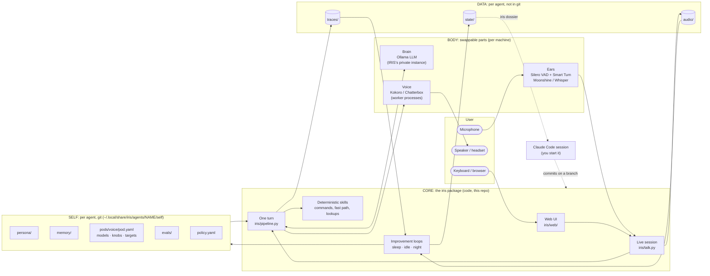
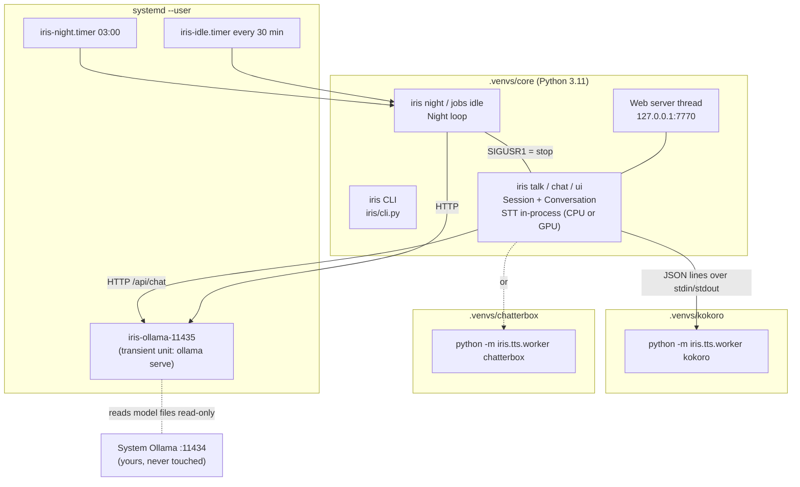
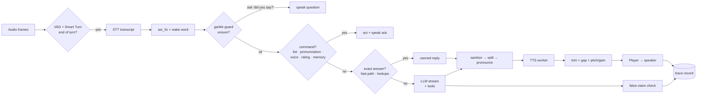

# 00 · System overview

> **Read this first.** It names every part of IRIS, shows how the parts connect, and maps every
> source file to the page that explains it. The other pages go one level deeper each.

IRIS is a voice assistant that runs entirely on one machine:

```
microphone → speech recognition → local LLM (Ollama) → text clean-up → voice → speaker
```

It improves itself **without retraining any model**: it changes what surrounds the models (memory,
prompts, settings, pronunciations, which model is used) and keeps every change in a git repository
it can roll back. When real engineering is needed, *you* run Claude Code on this repo and it works
from the data IRIS collected ([ADR-0011](../adr/0011-local-loops-measure-claude-code-engineers.md)).

## 1. The big picture



Three ideas carry the whole design:

1. **Body vs self** ([ADR-0003](../adr/0003-body-and-self-split.md)). Models are replaceable; what
   makes the assistant *itself* (persona, memory, settings, evals) lives in a versioned self store
   and survives any model swap.
2. **Code before model** ([ADR-0014](../adr/0014-deterministic-skills-before-the-model.md)). Anything
   that has one right answer (time, maths, unit conversion, exchange rates, list edits, voice
   commands) is done by deterministic code. The LLM handles conversation, and its claims are checked
   ([ADR-0015](../adr/0015-honesty-layer.md)).
3. **Measure locally, engineer deliberately** ([ADR-0011](../adr/0011-local-loops-measure-claude-code-engineers.md)).
   Small local models are good at measuring and poor at engineering. The loops change only small,
   bounded, reversible things on their own; everything else becomes a *finding* for a person or a
   Claude Code session.

## 2. Processes at run time

IRIS is several processes, because the voice engines need dependencies (torch versions) that clash
with each other and with the core ([ADR-0005](../adr/0005-one-venv-per-voice-engine.md)).



| Process | Started by | Lives in | Talks to |
|---|---|---|---|
| `iris talk` / `chat` / `ui` | you | core venv | Ollama (HTTP), TTS worker (pipes), browser (HTTP/SSE), hotkeys (unix socket) |
| TTS worker | the session or the night loop | `kokoro` or `chatterbox` venv | its parent only (stdin/stdout JSON lines) |
| IRIS's Ollama | `ollama_ctl.ensure()` when anything needs the LLM | systemd transient user unit `iris-ollama-11435` | HTTP on 127.0.0.1:11435 |
| Night / idle job | systemd timers (only if you ran `iris jobs enable`) or `iris night` | core venv | Ollama, TTS workers, the self store |

See [09 · Jobs and processes](09-jobs-and-processes.md).

## 3. Where the work happens: one turn, in one picture



The details of each box are in pages 01 to 05.

## 4. Hardware budget (the machine it was built for)

| Part | Spec | What it limits |
|---|---|---|
| GPU | GTX 1070, 8 GB, Pascal sm_61, no bf16 | one LLM (~3 GB for gemma4 e4b) + voice + GPU recogniser; CUDA 12 runners required |
| CPU | i5-12400F (6 cores / 12 threads) | Moonshine, Silero, Smart Turn, embeddings, CPU Whisper |
| RAM | 15 GB | night-loop models are loaded one at a time |
| OS | Arch / Omarchy, Wayland, systemd user session | timers, transient units, `notify-send` |

Measured GPU memory (runner processes, `nvidia-smi`): gemma4 e4b 4.33 GB with its vision+audio projector,
3.49 GB as the vision-only copy IRIS uses ([ADR-0030](../adr/0030-vision-only-llm-copy.md)); Kokoro ≈ 0.75 GB;
small.en int8 ≈ 0.37 GB loaded; large-v3-turbo int8 ≈ 1.1 GB loaded plus encoder working memory; Chatterbox
≈ 3.3 GB. The live stack (vision LLM + Kokoro + small.en@gpu) peaks at 6.5 of 8.2 GB including the desktop.
Ollama's own `size_vram` leaves out projectors, so `iris/vram.py` measures the runner. `iris/vram.py` checks the sum before
anything loads ([ADR-0016](../adr/0016-kokoro-default-voice-and-vram-preflight.md)).

## 5. Module map (every source file → its page)

Kept complete by `tests/test_docs.py`: a new module without a row here fails the tests.

| Module | One line | Page |
|---|---|---|
| `iris/__init__.py` | package marker, kept import-light for the TTS venvs | 00 |
| `iris/cli.py` | the `iris` command and every subcommand | [14](14-development.md) |
| `iris/paths.py` | where everything lives (IRIS_HOME, agent dirs, venvs) | [12](12-data-and-files.md) |
| `iris/util.py` | logging, JSON(L) helpers, WER, similarity, percentiles | [11](11-observability.md) |
| `iris/config.py` | `Settings` (self store → one object), knob edits, template sync | [07](07-self-store.md) |
| `iris/selfstore.py` | the self store git repo: commits, proposals, locked paths, rollback | [07](07-self-store.md) |
| `iris/locks.py` | PID-file locks `live` and `night` | [09](09-jobs-and-processes.md) |
| `iris/events.py` | non-blocking in-process event bus for UIs | [10](10-web-ui.md) |
| `iris/talk.py` | the live session: audio, turn-taking, wake word, commands from UIs | [02](02-listening.md) |
| `iris/audio.py` | microphone (PTT / VAD), `EnergyVAD`, `Recorder`, `Player` | [02](02-listening.md) |
| `iris/turn.py` | Silero VAD stream and the Smart Turn end-of-turn model | [02](02-listening.md) |
| `iris/stt.py` | Moonshine / Whisper (CPU and `@gpu`), hybrid long speech, CUDA lib preload | [02](02-listening.md) |
| `iris/garble.py` | "did you say …?" for unsure Whisper transcripts | [02](02-listening.md) |
| `iris/pipeline.py` | one turn: commands → fast path / lookups → LLM + tools → speech → trace | [01](01-runtime-turn.md) |
| `iris/llm.py` | Ollama HTTP client (stream, JSON, capabilities, warm/unload) | [03](03-thinking.md) |
| `iris/ollama_ctl.py` | IRIS's private Ollama instance and its config | [03](03-thinking.md) |
| `iris/memory.py` | facts, lessons, episodes; prompt assembly; semantic + BM25 recall | [06](06-memory.md) |
| `iris/actions.py` | forced/recovered search, list intent, false-claim detection, number grounding | [03](03-thinking.md) |
| `iris/fastpath.py` | time, date and arithmetic answered without the LLM | [05](05-commands-and-skills.md) |
| `iris/lookups.py` | exact units, time zones, exchange rates, weather, Wikipedia | [05](05-commands-and-skills.md) |
| `iris/lists.py` | the user's lists and the phrases that edit them | [05](05-commands-and-skills.md) |
| `iris/observations.py` | the reflection's hidden guesses (never on the lists) | [05](05-commands-and-skills.md) |
| `iris/voicefx.py` | live voice commands and audio rendering (trim, gaps, pitch, gain) | [04](04-speaking.md) |
| `iris/vram.py` | GPU memory pre-flight for voice + recogniser + LLM | [04](04-speaking.md) |
| `iris/trace.py` | trace records, audio files, session index | [11](11-observability.md) |
| `iris/metrics.py` | traces → the numbers the loops optimise | [11](11-observability.md) |
| `iris/evals.py` | eval cases, deterministic checks, regression harvesting | [08](08-learning-loops.md) |
| `iris/replay.py` | the replay benchmark: real utterances and what must happen (routing, commands, extraction) | [08](08-learning-loops.md#11-the-replay-benchmark) |
| `iris/jobs.py` | background jobs, pause/stop, systemd timers | [09](09-jobs-and-processes.md) |
| `iris/doctor.py` | `iris doctor`: checks every part | [14](14-development.md) |
| `iris/branches.py` | branch workflow: one improvement branch, variants, auto-sync | [14](14-development.md) |
| `iris/textproc/__init__.py` | package marker | 04 |
| `iris/textproc/sanitizer.py` | markdown/emoji/stage-direction removal, counted; `<think>` filter | [04](04-speaking.md) |
| `iris/textproc/cues.py` | delivery cues (`[pause]`, `[dry]`, …) parsing | [04](04-speaking.md) |
| `iris/textproc/splitter.py` | streaming text → speakable chunks (first clause / phrase early) | [04](04-speaking.md) |
| `iris/textproc/pronounce.py` | speakable text: units, symbols, number rules, exact entries, taught words | [04](04-speaking.md) |
| `iris/textproc/respell.py` | pronunciations taught by voice (respelling → phonemes) | [04](04-speaking.md) |
| `iris/textproc/asr_fix.py` | rule-based fixes for recurring mishearings | [02](02-listening.md) |
| `iris/tools/__init__.py` | tool registry, native vs text protocol, runner | [03](03-thinking.md) |
| `iris/tools/web.py` | web search (DuckDuckGo via ddgs, or SearXNG) | [03](03-thinking.md) |
| `iris/tools/calc.py` | safe arithmetic evaluator | [03](03-thinking.md) |
| `iris/tools/clock.py` | current date and time | [03](03-thinking.md) |
| `iris/tools/lists_tool.py` | `add_to_list` / `show_list` for the model | [05](05-commands-and-skills.md) |
| `iris/tools/lookup.py` | Wikipedia, exchange-rate and weather APIs (+ tools) | [05](05-commands-and-skills.md) |
| `iris/tts/__init__.py` | package marker | 04 |
| `iris/tts/client.py` | core-side handle on a TTS worker; tone engine; synth options | [04](04-speaking.md) |
| `iris/tts/worker.py` | the worker process (runs inside an engine venv) | [04](04-speaking.md) |
| `iris/tts/engines/__init__.py` | the engine contract | [04](04-speaking.md) |
| `iris/tts/engines/kokoro.py` | Kokoro-82M engine | [04](04-speaking.md) |
| `iris/tts/engines/chatterbox.py` | Chatterbox (turbo / original) engine | [04](04-speaking.md) |
| `iris/tts/engines/tone.py` | placeholder beep engine (tests) | [04](04-speaking.md) |
| `iris/improve/__init__.py` | package marker | 08 |
| `iris/improve/sleep.py` | after-session reflection: memory deltas, episodes, regression harvest | [08](08-learning-loops.md) |
| `iris/improve/night.py` | the night / idle loop and its stages | [08](08-learning-loops.md) |
| `iris/improve/tuner.py` | bounded knob experiments with automatic rollback; STT choice | [08](08-learning-loops.md) |
| `iris/improve/teacher.py` | big-Whisper grading, TTS round trips, pronunciation-rule tuning | [08](08-learning-loops.md) |
| `iris/improve/judge.py` | the overnight LLM judge | [08](08-learning-loops.md) |
| `iris/improve/gate.py` | the no-regression gate | [08](08-learning-loops.md) |
| `iris/improve/promptopt.py` | reflective prompt-edit candidates | [08](08-learning-loops.md) |
| `iris/improve/bench.py` | LLM / tool-choice / Ollama-setting benchmarks | [08](08-learning-loops.md) |
| `iris/improve/scout.py` | new packages, runtimes, models (never downloads) | [08](08-learning-loops.md) |
| `iris/improve/mine.py` | rule mining: recurring mishearings, list phrasings the matcher missed, failed turns → findings and replay candidates (proposals only) | [08](08-learning-loops.md#12-rule-mining) |
| `iris/improve/insights.py` | findings and the dossier for Claude Code | [08](08-learning-loops.md) |
| `iris/improve/report.py` | the morning report | [08](08-learning-loops.md) |
| `iris/improve/review.py` | proposals review/approve/reject, rollback, `iris rate` | [08](08-learning-loops.md) |
| `iris/autopilot/__init__.py` | package marker: the supervisor of the autopilot variant | [15](15-autopilot.md) |
| `iris/autopilot/config.py` | defaults, paths and state of the autopilot (`autopilot/config.yaml`, frozen-file list) | [15](15-autopilot.md) |
| `iris/autopilot/ledger.py` | tokens and provider errors per night; budget and stop-on-errors decisions | [15](15-autopilot.md) |
| `iris/autopilot/redact.py` | personal details → placeholders before anything is sent to the worker | [15](15-autopilot.md) |
| `iris/autopilot/gateway.py` | freellmapi client: catalog, probes, `doctor` | [15](15-autopilot.md) |
| `iris/autopilot/sandbox.py` | bubblewrap command builder (home hidden, network on/off) | [15](15-autopilot.md) |
| `iris/autopilot/fence.py` | frozen files, new network use, secrets, isolation checks on the worker's diff | [15](15-autopilot.md) |
| `iris/autopilot/workspace.py` | the worker's git clone, venv, pinned scorer, Codex config, sync/accept/reject | [15](15-autopilot.md) |
| `iris/autopilot/referees.py` | tests, holdout score and changelog checks | [15](15-autopilot.md) |
| `iris/autopilot/prompt.py` | the worker's standing instructions | [15](15-autopilot.md) |
| `iris/autopilot/night.py` | one supervised night: dossier, worker, fence, referees, accept or reject | [15](15-autopilot.md) |
| `iris/autopilot/digest.py` | the morning digest of a night | [15](15-autopilot.md) |
| `iris/autopilot/timer.py` | the nightly systemd user timer (opt-in) | [15](15-autopilot.md) |
| `iris/autopilot/cli.py` | `iris autopilot ...` subcommands | [15](15-autopilot.md) |
| `iris/web/__init__.py` | package marker | 10 |
| `iris/web/server.py` | stdlib HTTP server: static files, SSE, commands, snapshots | [10](10-web-ui.md) |

Static web files (`iris/web/static/index.html`, `app.js`, `core.js`, `style.css`) are described in
[10 · Web UI](10-web-ui.md).

## 6. Reading order

| If you want to … | Read |
|---|---|
| understand a conversation turn end to end | [01](01-runtime-turn.md) → [02](02-listening.md) → [03](03-thinking.md) → [04](04-speaking.md) |
| change what IRIS does for a phrase | [05](05-commands-and-skills.md) |
| know what it remembers and why | [06](06-memory.md) |
| know what may change by itself, and how to undo it | [07](07-self-store.md) → [08](08-learning-loops.md) |
| run, stop or schedule it | [09](09-jobs-and-processes.md) |
| debug from data | [11](11-observability.md) → [12](12-data-and-files.md) |
| change a setting | [13](13-configuration-reference.md) |
| develop, test, branch | [14](14-development.md) and [../BRANCHING.md](../BRANCHING.md) |
| understand or run the autopilot trial | [15](15-autopilot.md) |
| rebuild it somewhere else | [../REBUILD.md](../REBUILD.md) |
| know *why* it is built this way | [../adr/](../adr/README.md) |
