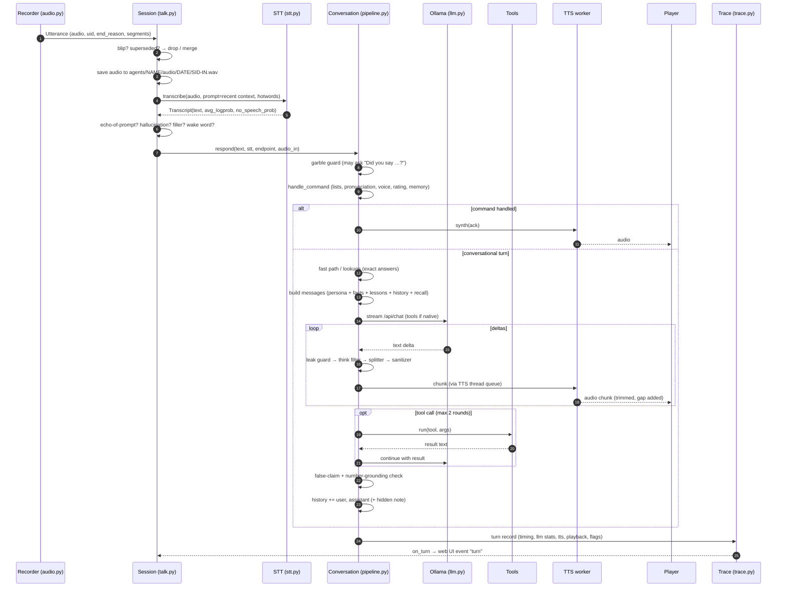
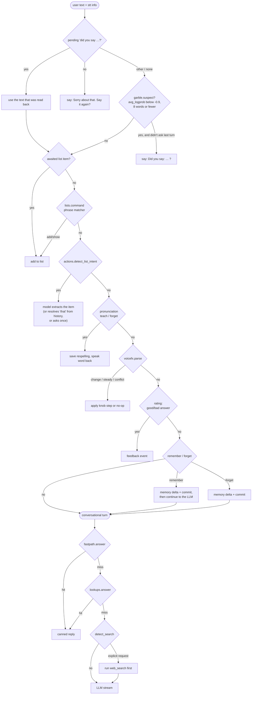
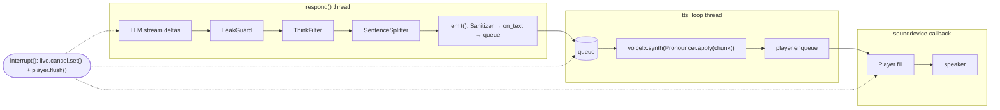

# 01 · One turn, end to end

Source: `iris/talk.py` (`Session`), `iris/pipeline.py` (`Conversation.respond`).

A **turn** is one thing the user says (or types) and IRIS's answer to it. Everything is timed from
the moment the end of the user's speech was decided (`t_end`), because the sum of the stages is
what the user feels, not any single stage.

## 1. The full sequence

## 2. Order of precedence inside `respond()`

The order matters: earlier stages win. Each was put in its place because a later stage used to
swallow its input (for example, the voice parser used to treat "add to improvements list that the
voice is too high" as a pitch command, so lists now come first).

Commands that are handled return early with a short spoken acknowledgement and do **not** create
a turn record (they write a trace *event* instead: `list`, `pronunciation`, `voice_feedback`,
`feedback`, `garble_*`).

## 3. Concurrency inside one turn

* The LLM keeps generating while earlier chunks are synthesised and played.
* `Conversation.interrupt(reason)` sets one cancel flag that the stream loop, the TTS loop and the
  player all check. The HTTP stream is closed, which stops generation inside Ollama.
* History keeps only what was actually heard; a reply cut by barge-in is stored with a trailing `...`.

## 4. Timing fields (seconds from `t_end`)

| Field | Set when |
|---|---|
| `timing.stt_done` | the transcript is ready (`Session._handle_audio`) |
| `timing.first_token` | the first LLM delta arrives |
| `timing.first_chunk` | the first speakable chunk leaves the splitter |
| `timing.first_chunk_synth` | that chunk has been synthesised |
| `timing.first_audio` | the player actually started the first chunk (what you hear) |
| `timing.done` | the turn is finished (all audio played or cancelled) |
| `timing.cut_at_length` | the reply hit `llm.num_predict` and was cut at a sentence |

The latency waterfall in the web UI and the `iris session` report are built from these.

## 5. Failure handling in a turn

| Failure | What happens |
|---|---|
| Ollama not reachable | `LLMError`; IRIS says "Sorry, my language model isn't responding."; `error` on the turn |
| IRIS's Ollama died | `Ollama._revive()` restarts the managed instance once and retries |
| Model writes its reasoning | `LeakGuard` holds the first sentence; on a leak nothing is spoken, one retry with a nudge, then `_switch_model` ([ADR-0013](../adr/0013-reasoning-leak-guard.md)) |
| Reply hits the token limit | ends on the last full sentence and adds the persona's `continue_offer` |
| TTS chunk fails | logged, `tts.error` on the turn, the next chunk continues |
| Model claims an action no tool did | `false_claim` on the turn, a finding, and a hidden `[note: …]` on that history entry ([ADR-0015](../adr/0015-honesty-layer.md)) |
| User keeps talking (hands-free) | the reply is cancelled with reason `resume`; the two utterances are merged ([02](02-listening.md)) |
