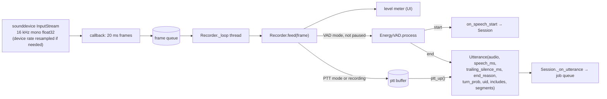
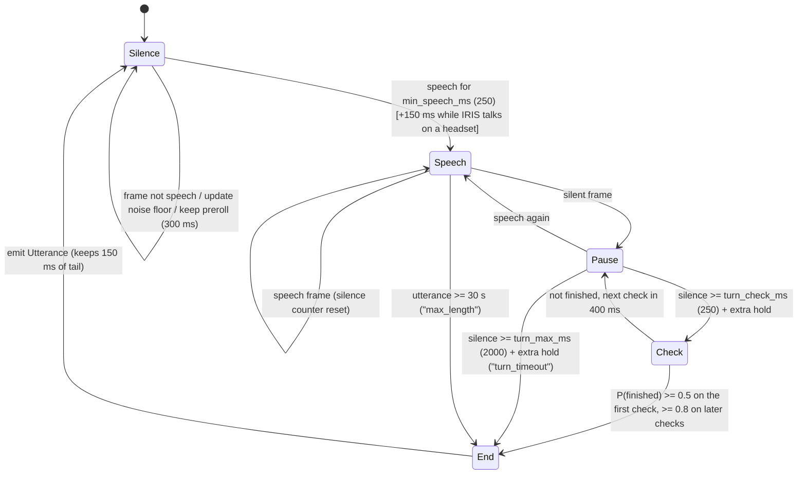
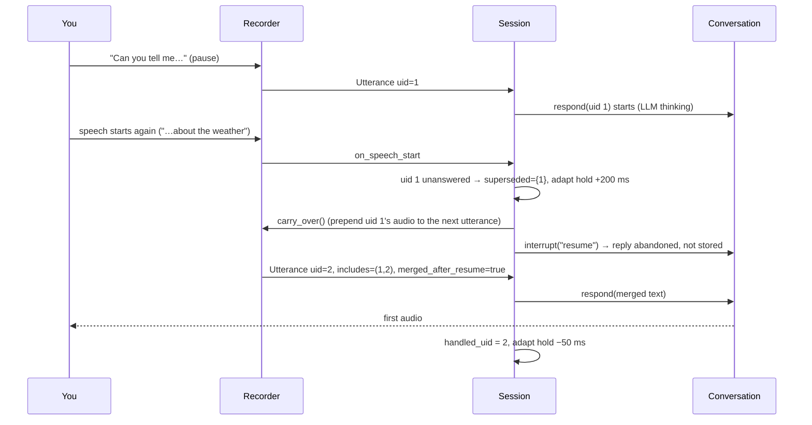
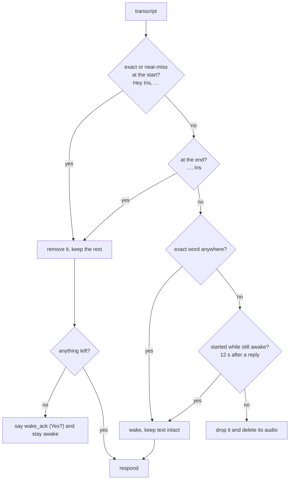
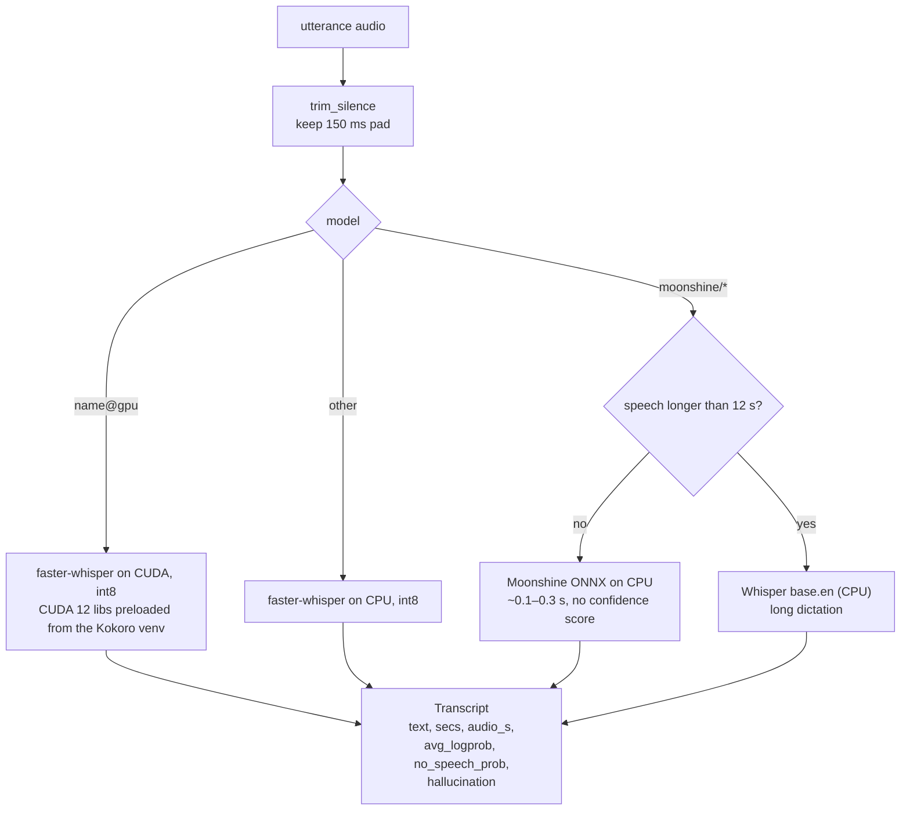
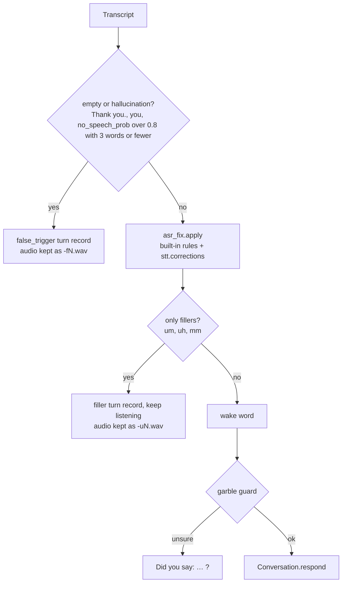
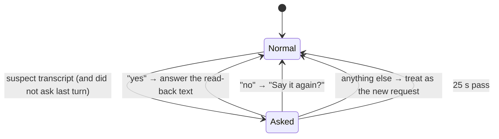

# 02 · Listening: microphone, turn-taking, speech recognition

Source: `iris/audio.py`, `iris/turn.py`, `iris/talk.py`, `iris/stt.py`, `iris/textproc/asr_fix.py`,
`iris/garble.py`. Decisions: [ADR-0012](../adr/0012-turn-taking-silero-smart-turn.md),
[ADR-0017](../adr/0017-speech-recognition-choices.md), [ADR-0018](../adr/0018-garble-guard.md).

## 1. From microphone to utterance

**Modes.** Push-to-talk (Enter, the web button, the hotkey `iris ptt down|up`) records between
down and up. Hands-free (`--vad`, `/vad`) uses the detector below. A blip under 200 ms (or 0.2 s
of audio) is ignored.

**Echo.** With speakers the microphone is paused while IRIS talks (half-duplex). With a headset
(`audio.headset: true`, `--headset`, or a mic name that looks like one) it stays open with a higher
threshold (`vad.barge_in_db`, +150 ms minimum speech) and talking over IRIS interrupts her.

## 2. The voice-activity detector and end of turn

`EnergyVAD` combines two questions: *is this frame speech?* and *has the speaker finished?*

* **Speech or not:** Silero VAD v6 (ONNX, shipped inside faster-whisper) gives a speech probability
  per 32 ms; speech starts above `silero_threshold` (0.5) and continues above it minus 0.15. With
  `vad.engine: energy` a loudness threshold over a tracked noise floor is used instead.
* **Finished or not:** the Smart Turn v3.2 model (Pipecat, BSD-2, ~8 MB ONNX, downloaded once from
  Hugging Face) reads the last 8 s of audio as Whisper-style log-mel features and returns
  P(finished). It hears intonation, so "I want to…" waits and "What time is it?" ends early.

**Extra hold.** People dictating pause between sentences, and Smart Turn answers "has *this
sentence* ended?". So every turn waits a little longer than the model alone would:

| Part | Source | Value |
|---|---|---|
| baseline | knob `vad.turn_hold_ms` (auto-tuned) | 0 to 800 ms |
| this session's learning | `EnergyVAD.adapt_ms` | +200 ms (`vad.hold_step_ms`) each time you resume after a cut-off, up to 600 ms (`vad.hold_max_ms`); −50 ms (`vad.hold_decay_ms`) per clean turn |
| long speech | `vad.long_speech_ms` / `long_speech_extra_ms` | +200 ms after 5 s of continuous speech |

The tuner rule for `vad.turn_hold_ms` uses the cut-off rate (`premature_eos_rate`); see
[08](08-learning-loops.md). (A higher Smart Turn threshold was measured and rejected: the model was
91–99 % sure at the real cut points, which were sentence ends.)

## 3. Turn-taking across utterances: merging, superseding, never talking over you

Every utterance gets a `uid`. If you start speaking again **before the reply to your previous
utterance is audible**, that utterance was not the end of your turn: it is merged into the next one
and marked *superseded*, so it is never answered on its own.

Rules implemented in `Session` (`_user_still_talking`, `_on_first_audio`, `_is_superseded`):

* The reply never starts while you are mid-sentence: when the first chunk is ready but the VAD is
  in speech, the turn is treated as unfinished.
* An abandoned question is never lost, however long the pause (`Recorder.carry_over`).
* `vad.resume_window_ms` (1000) additionally merges speech that resumes that quickly even before a
  reply began.
* A merged utterance never grows past 60 s.
* After IRIS finishes speaking with speakers, the mic waits 250 ms for the room to go quiet.

Each end-of-turn decision is logged in `endpoint.segments` (probability, trailing silence, speech
length, reason, extra hold), so cut-offs can be studied later.

## 4. Wake word

With `wake.enabled` (or `--wake`) every utterance is still transcribed, then `strip_wake()` decides:

Near-misses (`Irish`, `Irus`, `Iras`, …) only count at the start or end, so "the iris of the eye"
stays a normal sentence.

## 5. Speech recognition

Whisper is called with `language=en`, `beam_size` from the `stt.beam_size` knob,
`condition_on_previous_text=False`, `temperature=(0.0, 0.4)` (at most one retry, because the default
five re-decodes multiplied latency on noise), and two hints:

* **prompt** (`stt.context` knob): the end of IRIS's last reply plus capitalised names from the
  conversation, so a name heard once is spelled the same way next time. A transcript that merely
  repeats this hint is discarded (`_echoes_prompt`).
* **hotwords**: the agent's name, list words, `stt.hotwords` from pod.yaml and capitalised names from
  memory facts.

**Measured accuracy** on 202 of the user's own recordings, graded against large-v3-turbo with beam 5
(word error rate, lower is better; turbo's own score is optimistic because it is also the reference):

| Recogniser | WER | median time | where |
|---|---|---|---|
| live transcripts (Moonshine) | 24 % | | |
| moonshine/base | 26 % | 0.17 s | CPU |
| base.en | 23 % | 0.57 s / 0.07 s | CPU / GPU |
| small.en | 18 % | 1.6 s / 0.17 s | CPU / GPU |
| large-v3-turbo | **5 %** | 0.59 s (p90 0.83 s) | GPU int8, ~1.1 GB |

The live agent uses `large-v3-turbo@gpu` since 2026-10-18. If it can't load (no CUDA libraries, not
enough GPU memory, see `vram.plan`), the session falls back to `moonshine/base`, then `base.en`.

**GPU without extra installs.** CTranslate2's CUDA build needs `libcublas.so.12` and `libcudnn.so.9`.
The system has CUDA 13, but the torch wheels in `.venvs/kokoro` (or `chatterbox`) ship CUDA 12 copies;
`stt.preload_cuda_libs()` loads them by path with `ctypes` (RTLD_GLOBAL) before the model.

## 6. After the transcript: discard, fix, confirm

* **asr_fix** rewrites only patterns that are nearly always wrong in this domain: "my future list" →
  "my feature list", "a bit monitor" → "a bit monotone", "two fast" → "too fast", "to do list" →
  "todo list". Your own: `stt: {corrections: {"regex": "replacement"}}`.
* **Garble guard** (`iris/garble.py`): a Whisper transcript with average log-probability below
  `stt.confirm_logprob` (−0.9) and 1–8 words is read back as "I'm not sure I heard that right. Did
  you say: …?". Measured: ~5 % of turns, 82–100 % of those were really wrong. Rules: yes/no replies and
  short answers to IRIS's own question are never questioned; it never asks twice in a row; "yes" runs
  the read-back text, "no" asks you to repeat, anything else is a new request; the question expires
  after 25 s. Moonshine gives no confidence, so with Moonshine it never asks.

## 7. Microphone diagnostics

`iris mic` records a few seconds, prints the level, what Whisper hears and the device used;
`iris mic --list` lists devices. A false trigger whose loudest sample is below −30 dBFS prints a hint
to run it. Device choice: `--mic`, then `$IRIS_MIC`, then `audio.input_device`, else the default.
