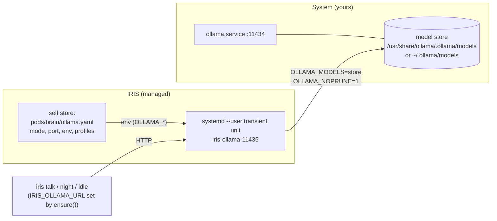
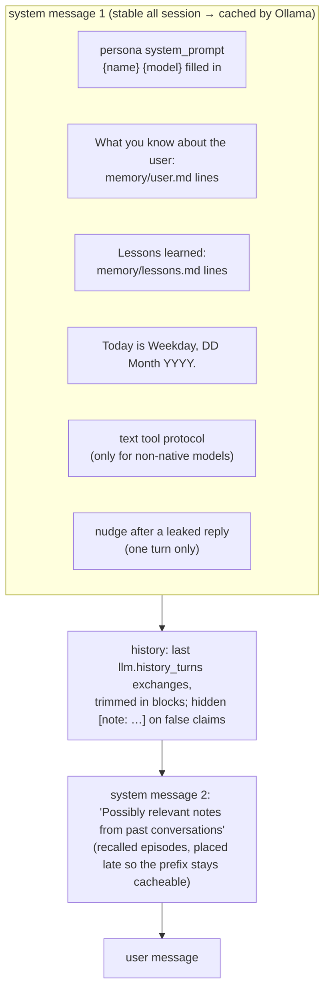
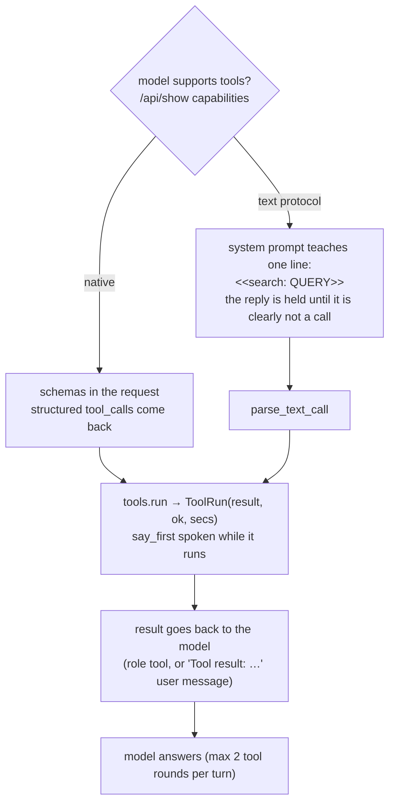
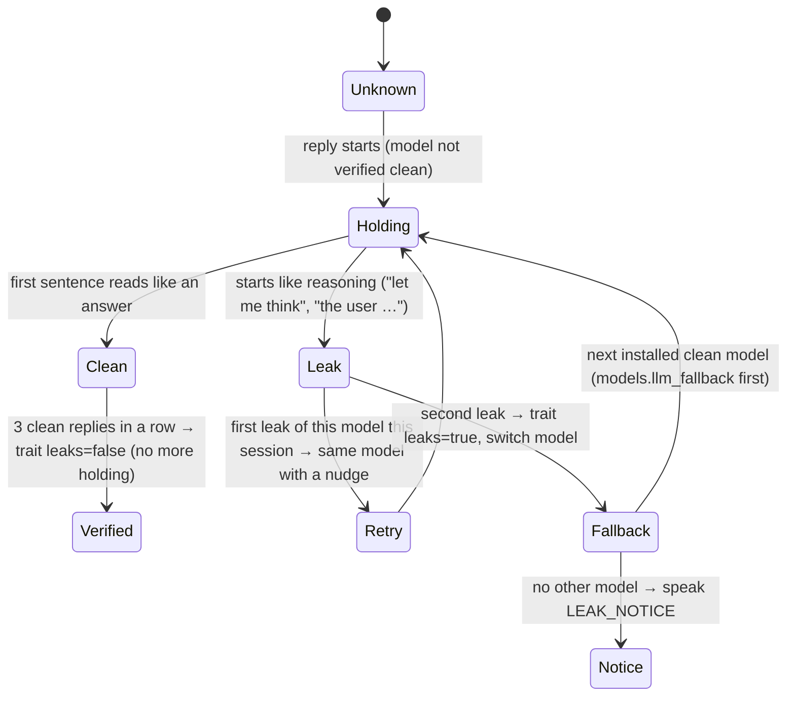
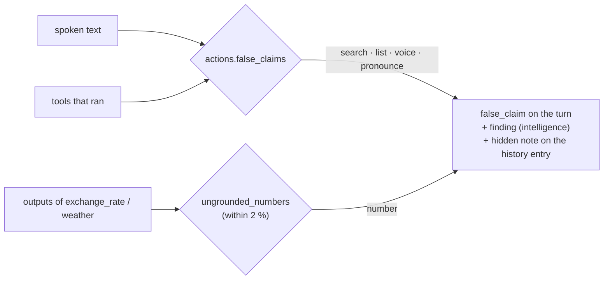

# 03 · Thinking: the LLM, its Ollama, prompts, tools and honesty

Source: `iris/llm.py`, `iris/ollama_ctl.py`, `iris/memory.py` (prompt assembly), `iris/pipeline.py`,
`iris/tools/`, `iris/actions.py`. Decisions: [ADR-0006](../adr/0006-private-ollama-instance.md),
[ADR-0013](../adr/0013-reasoning-leak-guard.md), [ADR-0015](../adr/0015-honesty-layer.md).

## 1. IRIS's own Ollama

IRIS never changes the system Ollama (the user runs it for other things). It starts its own
`ollama serve` that **reads the system's downloaded models read-only** but has its own server
settings.

| Function | What it does |
|---|---|
| `ensure(settings)` | if `mode: managed` and nothing answers on the port, start the unit (or a plain subprocess when systemd isn't usable), wait up to 25 s, set `IRIS_OLLAMA_URL`; on failure fall back to the system URL and log it |
| `release()` | when a session or job ends: stop the instance unless a `live` or `night` lock is still held |
| `stop()` | `systemctl --user stop iris-ollama-11435` (or SIGTERM/SIGKILL the pid group) |
| `temporary(env)` | a throwaway instance on a random port with other server settings (benchmarks) |
| `profile(model)` | per-model request options (`num_batch`, `num_gpu`, `num_thread` …) merged over the knobs |
| `set_key` / `set_profile` | the only writers of `ollama.yaml` (`iris ollama set|profile`), never the loops |

Why a transient systemd unit: a oneshot job's cgroup is killed when the job ends, which once took
a running conversation's LLM down with it. The unit lives on its own.

Default server env: `OLLAMA_KEEP_ALIVE=30m`, `OLLAMA_NUM_PARALLEL=1`, `OLLAMA_MAX_LOADED_MODELS=1`.
`mode: external` (or `IRIS_OLLAMA=external`) uses `$OLLAMA_HOST` as it is.

## 2. The LLM client

`Ollama(model)` is a thin adapter over `/api/chat`, streaming:

* `stream(messages, options, cancel, stats, think=False, fmt, tools, tool_calls)` yields text deltas and
  fills `LLMStats` (ttft, load time, prompt tokens, prompt eval time, tokens, tok/s, done_reason).
  `think=False` is sent; a model that rejects the flag gets the request again without it.
* `complete` / `complete_json` (format=json, with a fallback that extracts the first `{…}`).
* `capabilities()` from `/api/show` (cached): `tools` → native tool calling.
* `warm(options)` loads the model with the **same load options** as the chat (`num_ctx`, `num_batch`,
  `num_gpu` …): a different value makes Ollama reload the model, 10–16 s on this GPU.
* `installed_models`, `running` (`/api/ps`, VRAM), `unload`, `version`.

Request options per reply (`pipeline.llm_options`): knobs `llm.temperature`, `llm.num_predict`,
`llm.num_ctx`, then the model's profile from `ollama.yaml` on top.

## 3. Prompt assembly

**History trimming in blocks.** A window that slides by one exchange per turn changes the start of
the prompt every turn, so Ollama can't reuse its cache and re-reads the whole conversation (seconds
here). Once more than `llm.history_turns` exchanges exist, the older half is dropped at once; the
prefix then stays the same for the next `history_turns/2` replies (`Conversation.context`).

## 4. Tools

A tool is `Tool(name, description, parameters, run, say_first, text_form, text_arg)` and returns plain
text. Registry (`tools.registry`): `web_search`, `calculator`, `current_time`, `add_to_list`,
`show_list`, `wikipedia`, `exchange_rate`, `weather`, filtered by `tools.enabled` in pod.yaml.

**Forced and recovered tool calls** (`iris/actions.py`, [ADR-0015](../adr/0015-honesty-layer.md)):

* `detect_search(text, awaiting, previous)`: an explicit request ("search the web for …", "look that
  up", "what's the latest news …", or a topic right after IRIS asked "what should I search for?") runs
  `web_search` *before* the model is asked; the model only answers from the results.
* `announces_search(reply)`: the model said "let me search" but called nothing → the search runs now.
* `clean_query` turns a spoken request into a query (fillers, "can you", "and tell me" removed).

## 5. Reasoning-leak guard and model fallback

Some model builds ignore `think: false` and write their chain of thought as the reply ("Okay, the user
wants…"). IRIS must never speak that.

* Traits live in `state/model_traits.json` (`leaks`, `checked`); a `leaks: true` verdict expires after
  3 days so one bad day isn't permanent. The bench stage probes each model ("2 plus 2, one word").
* Holding the first sentence costs latency, so verified-clean models skip it.
* `_switch_model` order: `models.llm_fallback`, then installed models already verified clean, then
  any other installed model (embedding models skipped). The switch is a trace event `model_fallback`.

## 6. Honesty checks after the reply

| Kind | Example claim | Allowed when |
|---|---|---|
| `search` | "I've searched / looked it up" | `web_search` ran |
| `list` | "Improvements list updated", "I've added that" | `add_to_list` or `show_list` ran |
| `voice` | "I'll sound more enthusiastic" | never (only commands change the voice) |
| `pronounce` | "I will adjust my pronunciation" | never (teach it: "the word X is pronounced Y") |
| `number` | figures not present in the rate/weather tool output | — |

The note (`actions.NOTES`) is appended as `[note: …]` to that assistant message in the history the
model sees, never spoken, so a false claim is not taken as precedent. (Measured: with false claims in
the history the model's tool calls fell from 4/8 to 0/8.)

## 7. Other tools

* `calculator` (`tools/calc.py`): an AST evaluator over numbers, `+ - * / // % **`, and a few math
  functions; exponents over 1000 refused.
* `current_time` (`tools/clock.py`): local date/time with time zone.
* `web_search` (`tools/web.py`): DuckDuckGo via `ddgs` (no key), 3 attempts alternating text/news
  index; or your SearXNG (`tools.searxng_url` / `IRIS_SEARXNG`). Offline under `IRIS_OFFLINE`.
* `wikipedia`, `exchange_rate`, `weather` (`tools/lookup.py`) and the list tools: see
  [05](05-commands-and-skills.md).
