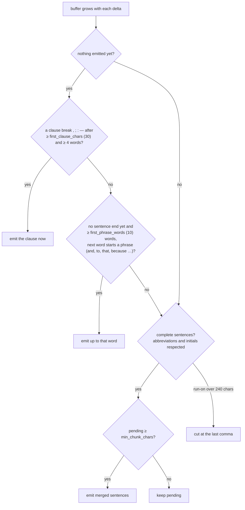
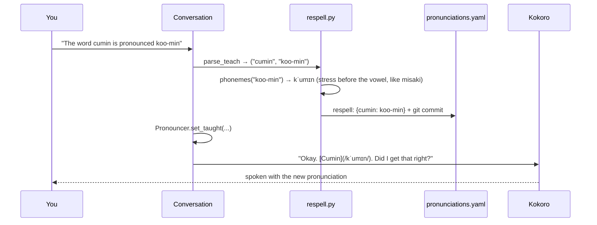
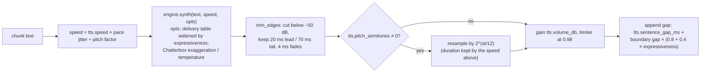
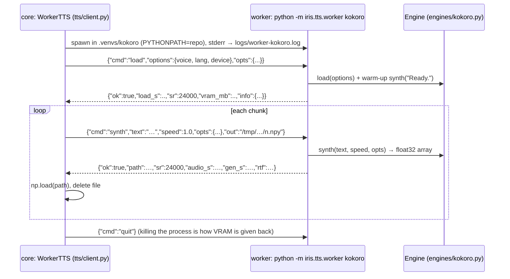
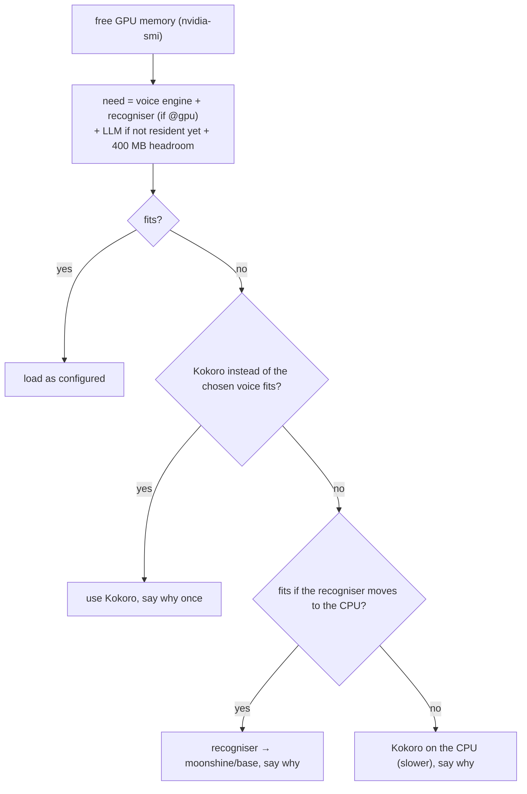

# 04 · Speaking: from model text to sound

Source: `iris/textproc/sanitizer.py`, `cues.py`, `splitter.py`, `pronounce.py`, `respell.py`,
`iris/voicefx.py`, `iris/tts/`, `iris/audio.py` (`Player`), `iris/vram.py`.
Decisions: [ADR-0005](../adr/0005-one-venv-per-voice-engine.md),
[ADR-0007](../adr/0007-streaming-first-sentence.md), [ADR-0008](../adr/0008-sanitizer-and-cue-vocabulary.md),
[ADR-0016](../adr/0016-kokoro-default-voice-and-vram-preflight.md),
[ADR-0020](../adr/0020-steady-pitch-and-taught-pronunciations.md).

## 1. The chain

```mermaid
flowchart LR
    D[LLM deltas] --> TF["ThinkFilter<br/>drops &lt;think&gt; blocks across deltas"]
    TF --> SP["SentenceSplitter<br/>first clause / phrase early,<br/>then ≥ min_chunk_chars"]
    SP --> SA["Sanitizer.clean<br/>markdown · emoji · stage directions ·<br/>unknown [tags] removed and counted"]
    SA --> Q[(TTS queue)]
    Q --> PR["Pronouncer.apply<br/>units/symbols · number rules ·<br/>exact entries · taught words"]
    PR --> VF["voicefx.synth<br/>speed · pace jitter · pitch · gain"]
    VF --> W["TTS worker<br/>Kokoro / Chatterbox"]
    W --> TR["trim_edges<br/>(engine padding removed)"]
    TR --> GAP["gap by boundary:<br/>sentence 170 · clause 80 · phrase 25 ms"]
    GAP --> PL["Player queue → speaker"]
```

## 2. Sanitizer and delivery cues

Small local models leak formatting. Everything removed is **counted** (`sanitized` on the turn), and
the counts are the `format_violations_per_turn` metric the loops track.

| Removed | Becomes |
|---|---|
| `<think>…</think>` | nothing (`think` count) |
| code fences, headings, bullets, bold, inline code, links | plain words (`markdown`) |
| URLs | "a link" (`urls`) |
| `*smiles*`, `(laughs)` | nothing, or the matching cue `[laugh]` if the persona allows it (`stage`) |
| emoji | nothing (`emoji`) |
| `[anything]` not in the persona's cue vocabulary | nothing (`invalid_cues`, names kept in `invalid_tags`) |

**Cues** are the only markup the model may write: tones (`calm warm dry playful excited serious whisper
sad`) and events (`pause`, `long pause`, `laugh`, `chuckle`, `sigh`, `gasp`), defined in the persona
(`cues:`). `cues.parse` splits text into segments; each engine renders what it can (Kokoro: pauses and
a speed per tone; Chatterbox turbo: native `[laugh] [chuckle] [sigh] [gasp]`) and drops the rest. A
`[word](/phonemes/)` pronunciation override is **not** a cue (the tag pattern refuses `](/`).

## 3. Splitter: speak sooner

The first chunk goes out as soon as it is speakable; later sentences are merged until
`splitter.min_chunk_chars` (60) for natural prosody and less per-chunk overhead.

A cue on its own (`[pause]`) waits for the sentence it belongs to.

## 4. Making text speakable (Pronouncer)

Applied to every chunk right before synthesis, per engine:

1. `normalise()` (always): units (`5 km` → "5 kilometres", `°C`), symbols (`e.g.`, `&`, `→`, `~`),
   e-mail addresses and web addresses spoken as words.
2. **Rules** enabled per engine in `pronunciations.yaml: rules:` (currency, percent, math, times,
   decimals, thousands, ordinals). The night loop toggles them only when a speech round trip
   (voice → Whisper → compare) is understood better ([08](08-learning-loops.md)).
3. **Entries**: exact replacements (`GPU` → "G P U").
4. **Taught words** (`respell:`): words you taught by voice.

### Teaching a pronunciation by voice

* The respelling is plain English (`oo` = goose, `ee` = fleece, `ay` = face, `uh` = strut/schwa …;
  CAPITALS mark the stressed syllable, otherwise the first one). IPA in slashes is accepted from typed
  input.
* Kokoro gets misaki's inline phoneme override `[word](/phonemes/)`. Other engines get the respelling as
  words ("koo min"). Measured: misaki reads "Cumin" as `kˈʌmən`; the override makes it `kˈumɪn`. A
  respelling with hyphens fed to Kokoro as text breaks (`❓`), which is why it is converted.
* "Forget the pronunciation of cumin" removes it. Spelled forms work: "cumin is spelled C U M I N, say
  it koo-min".

## 5. `voicefx.synth`: the live voice settings

* **One steady pitch.** Pitch changes only when you ask (`tts.pitch_semitones`). An earlier version
  drifted pitch per sentence (±1.5 semitones, questions lifted); you heard "sometimes deeper, sometimes
  higher". Measured on real Kokoro audio: median-F0 spread across sentences 3.1 → 1.4 semitones, and
  what remains is Kokoro's own intonation.
* **Pace variety** stays: at most ±3 % at full expressiveness, deterministic per text.
* **Why trim:** engines pad every chunk with silence (Kokoro ≈ 0.3 s before, 0.54 s after), which made
  ~0.8 s of dead air at every sentence boundary. Trimming plus a deliberate gap removed it.

## 6. TTS workers

Each engine runs in its own virtualenv because their torch builds clash
([ADR-0005](../adr/0005-one-venv-per-voice-engine.md)).

**Engine contract** (`iris/tts/engines/__init__.py`): a module with class `Engine` having `name`, `sr`,
`load(options) -> info`, `synth(text, speed, opts) -> float32 mono`. Adding an engine = one module + an
install function in `setup.sh` + its name in `models.tts_engine.choices`.

| Engine | Model | VRAM | Notes |
|---|---|---|---|
| `kokoro` (default) | Kokoro-82M, misaki G2P | ~0.8 GB | voice mix `af_heart:60,bf_emma:40`; `lang` a (US) / b (UK); speed per tone |
| `chatterbox` | Resemble AI Chatterbox (turbo / original) | ~3.3 GB | cloning (`reference` ≥ 5 s clip), native laugh/sigh tags (turbo), `exaggeration` (original); text cut into ~200-char pieces; speed via librosa time-stretch if present |
| `tone` | beeps | 0 | tests and placeholder |

## 7. GPU memory pre-flight

Chatterbox + the LLM + a GPU recogniser can exceed 8 GB, which once crashed Ollama mid-session.
`vram.plan()` runs **before anything loads** (`Session.boot`, `iris say`, the night loop's voice stage,
`iris doctor`).

Sizes come from, in order: `tts.<engine>.vram_mb` in pod.yaml, what was learned from real loads
(`state/vram.json`: worker peak + 300 MB CUDA context; LLM `size_vram` from `/api/ps`), the benchmark's
measurement (`state/bench.jsonl`), then defaults (Kokoro 800, Chatterbox 3300 MB, turbo 1500 MB). The
LLM's file size is the last resort only: gemma4 e4b is 7 GB on disk but ~3 GB on the card.

## 8. Playback and barge-in

`Player` keeps one reply at a time: `begin_reply` → `enqueue(chunk)` → `end_reply`; `flush()` drops
everything (barge-in). It measures first-audio time, underruns (ran dry mid-reply = the voice fell
behind), the largest gap, seconds played, and which chunks started (so the history stores only what was
heard). `on_chunk_start` publishes the caption being spoken to the web UI. `FakeClockPlayer` "plays"
without a sound card (`--no-audio`, tests).
