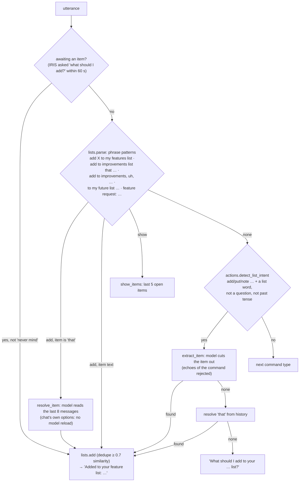
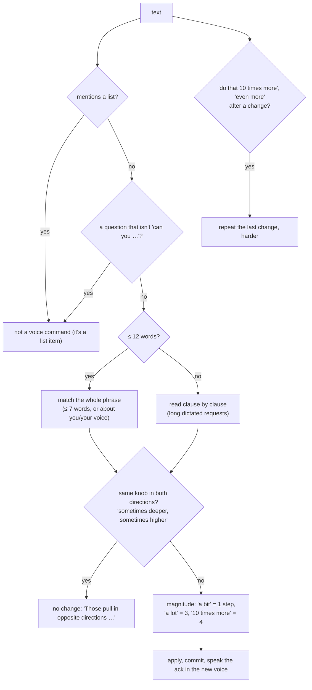
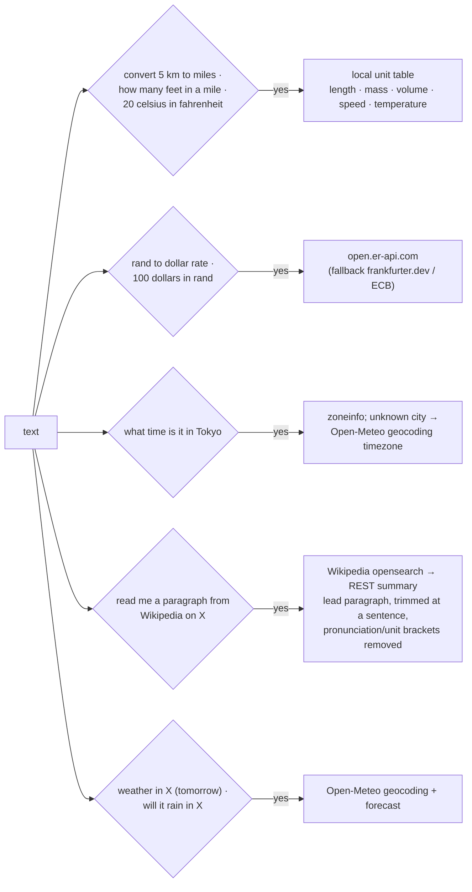

# 05 · Commands and deterministic skills

Source: `iris/pipeline.py` (`handle_command`, `respond`), `iris/lists.py`, `iris/observations.py`,
`iris/tools/lists_tool.py`, `iris/voicefx.py` (parsing), `iris/textproc/respell.py`, `iris/memory.py`
(remember/forget), `iris/fastpath.py`, `iris/lookups.py`, `iris/tools/lookup.py`.
Decisions: [ADR-0014](../adr/0014-deterministic-skills-before-the-model.md),
[ADR-0019](../adr/0019-lists-only-explicit-requests.md), [ADR-0025](../adr/0025-explicit-network-lookups.md).

**Principle:** anything with one right answer is done by code, the same way every time, with any
model. The model is only asked for what code can't do (and even then its claims are checked). The
order in which these run is in [01 · One turn](01-runtime-turn.md#2-order-of-precedence-inside-respond).

## 1. Lists (todo, features, improvements)

Your lists are the main input for the next Claude Code session (`iris dossier` → `lists.md`).
**Only what you ask for is on them.** The after-session reflection's guesses go to hidden
*observations* instead ([ADR-0019](../adr/0019-lists-only-explicit-requests.md)).

* Phrase matching tolerates what speech recognition does: no determiner ("add to improvements
  list"), fillers after the list name, "future list" heard for "feature list" (an alias).
* **The model's own tool** `add_to_list` refuses unless the current user text mentions adding or a list
  (`lists.user_asked`), so the model can't "note" things on its own initiative.
* Claims like "Improvements list updated" without a list tool are flagged as false claims.
* Storage: `state/lists.jsonl`, one item per line: `{id, list, text, source, status, ts, session, turn,
  note, closed_ts}`; `status` is `open | done | dropped` (legacy `suggested` items may exist).
* CLI: `iris list [name] | add TEXT --to features | done ID --note SHA | drop ID | open ID | --all`.
* Web UI: the LISTS panel (add / done / drop).

**Observations** (`iris/observations.py`, `state/observations.jsonl`): requests and capability gaps the
reflection *inferred*, at most 3 per session, deduplicated. Shown only in the dossier ("model's guesses,
verify") and `iris observations`; `iris observations promote <id>` turns a confirmed one into a real
improvements item; `dismiss` hides it.

## 2. Voice commands

`voicefx.parse(text, last)` maps spoken feedback to one bounded step of one knob, applied immediately
(`settings.overrides`) and saved to pod.yaml as a commit, with an undo stack.

| You say | Knob | Step |
|---|---|---|
| "too fast", "slower" / "too slow", "faster" | `tts.speed` | ±0.05 |
| "louder", "can't hear you" / "quieter" | `tts.volume_db` | ±2 dB |
| "too deep", "higher" / "too high", "deeper" | `tts.pitch_semitones` | ±1 |
| "too monotone", "more expression" / "calmer", "too dramatic" | `tts.expressiveness` | ±0.25 |
| "longer pauses" / "fewer pauses" | `tts.sentence_gap_ms` | ±100 ms |
| "undo that", "change it back" | the last change | — |
| "stick with this voice", "keep it steady", "don't change the voice" | nothing ("Okay, I'll leave my voice as it is.") | — |

The web UI's voice sliders call `voicefx.set_knob` directly.

## 3. Pronunciations

"The word X is pronounced Y", "say X like Y", "X is spelled C U M I N, say it Y", "forget the
pronunciation of X". See [04 · Speaking](04-speaking.md#teaching-a-pronunciation-by-voice).

## 4. Ratings and memory commands

| You say / type | Effect |
|---|---|
| `+` `/good` "good answer" · `-` `/bad` "bad answer" · `=` `/ok` | `feedback` event on the last turn (the strongest learning signal) |
| "bad answer, too long" / "good response, you explained it clearly" | rating plus the reason (`note`) |
| "remember that my sister is called Ana" | fact added to `memory/user.md` now (rewritten to third person), committed; the LLM still answers |
| "forget that …" | matching fact removed, committed |

A rating with a question in it is a normal turn ("good answer, but why is the sky blue?").

## 5. Fast path: exact answers without the model

`fastpath.answer(text)` only fires when the **whole** utterance is one of these, so "what time does
the game start?" is never hijacked:

* time ("what's the time"), date ("what day is it");
* arithmetic in words or digits: "what's seventeen times twenty three", "15 percent of 240", "square
  root of 81", "2 to the power of 10". Spoken numbers are read whole (`_numbers_to_digits`: "twenty
  three" = 23, "one thousand two hundred" = 1200, "three point five"); two numbers side by side are
  refused rather than guessed (this fixed "17 × 23 = 3,451"). Evaluated by the safe calculator.
  A property test checks 3000 random sums.

## 6. Lookups: exact data, never paraphrased

`lookups.answer(text, settings)` runs after the fast path. Units and time zones are computed locally;
the rest call free public APIs that need no key (`iris/tools/lookup.py`):

* Requests are matched as said and again without their wrapper, so "Please search up and tell me what the weather
  is in Cape Town currently", "You search what the current exchange it is from rands to U. S. dollars", "What about
  yen to rand" and "They read a paragraph from Wikipedia on the Odyssey movie" all land (real phrasings from the
  traces); two-part requests ("the time and weather in …") and requests without a topic go to the model.
* The answer is spoken as computed (a `_Canned` stream through the normal speech chain), recorded as
  `fastpath: units | currency | timezone | wikipedia | weather` on the turn.
* A failed lookup is *said* ("I couldn't reach the service just now"), never filled in by the model.
  Each request retries once on a dropped connection; `IRIS_OFFLINE` disables the network.
* "What's the weather?" with no place uses `location:` from pod.yaml, or asks which place.
* Only the topic, currency pair or place is sent, and only when you ask
  ([ADR-0025](../adr/0025-explicit-network-lookups.md)). `lookups: {enabled: false}` turns this off.
* The model can call the same data as tools (`wikipedia`, `exchange_rate`, `weather`) for other
  phrasings; figures in its reply that are not in the tool output are flagged (`false_claim: number`).

## 7. Adding a new deterministic skill

(Cases for a new skill go into the replay benchmark, [08 §11](08-learning-loops.md#11-the-replay-benchmark).)

1. Put the matcher and the answer in a small module (pure function `text -> answer | None`), matching
   only complete utterances.
2. Call it from `Conversation.respond` (exact answers) or `handle_command` (actions), in the right
   precedence slot.
3. Add replay tests with real phrasings to `tests/test_session_replay.py`, including phrases it must
   **not** match.
4. Document it here, add a CHANGELOG entry, and an ADR if it changes how the system behaves in general.
