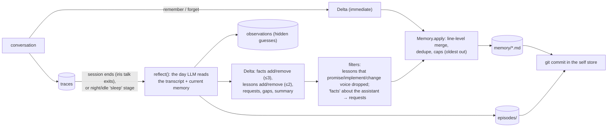
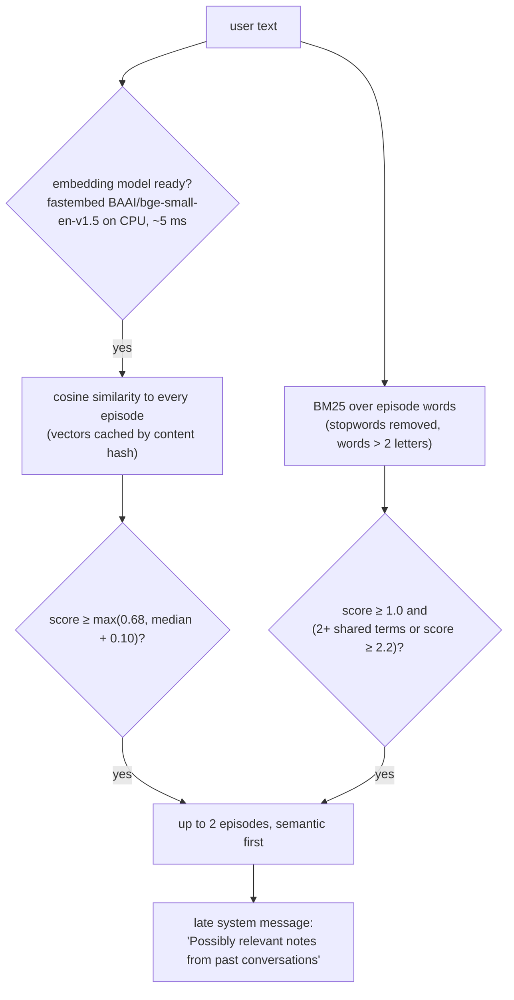

# 06 · Memory

Source: `iris/memory.py`, `iris/improve/sleep.py`. Decision:
[ADR-0009](../adr/0009-incremental-memory-and-recall.md).

IRIS learns by **writing notes**, never by changing model weights. All notes are plain markdown in the
self store (git-tracked, human-editable).

| File | Holds | In the prompt | Written by |
|---|---|---|---|
| `memory/user.md` | durable facts about you, one `- ` line each (cap `memory.max_user_facts` 80) | always (system message) | sleep reflection; "remember that …" immediately |
| `memory/lessons.md` | behaviour playbook "When …, …" (cap `memory.max_lessons` 30) | always | sleep reflection |
| `memory/episodes/DATE-SESSION.md` | 2–3 sentence summary of each past conversation | only when relevant (recall) | sleep reflection |

## 1. Lifecycle

**Why deltas, not rewrites:** a model that rewrites its whole memory each time slowly erodes details
("context collapse"). Line-level add/remove with deduplication (similarity ≥ 0.8 = duplicate on add,
≥ 0.6 = match on remove) keeps every unrelated line intact. This follows ACE-style itemized playbooks.

**Why core notes change only between sessions:** they sit at the start of the system prompt, so a
stable prefix lets Ollama reuse its prompt cache every turn.

## 2. Recall

The thresholds are measured: unrelated text scored 0.50–0.64 against real summaries and related text
0.66+; the older 0.6 floor injected an irrelevant note on half the turns of a session. The embedding
model loads in the background at session start (`warm_semantic`); until then recall is keyword-only.

## 3. The reflection prompt (what it may and may not record)

`REFLECT_SYSTEM` tells the day model to be conservative: only durable facts the user stated about
themselves; lessons only when the transcript shows a clear problem (a correction, a repeat, an
interruption, a bad rating), and only about *what to say next time*, never about changing the voice,
logging, promising or implementing. Code then enforces it: `keep_lessons` drops lessons matching
"implement / from now on / adjust your voice / promise …", and `split_requests` moves "facts" about the
assistant to requests. Requests and capability gaps become hidden observations
([05](05-commands-and-skills.md#1-lists-todo-features-improvements)).

## 4. Failure harvesting (from the same pass)

Turns that went badly become permanent regression eval cases in `evals/regressions/DATE.yaml`
([08](08-learning-loops.md)): rated bad, followed by "what?" / a repeat / a correction, interrupted
late in a long reply, or containing ≥ 2 unspeakable format violations.

## 5. Moving memory to another agent or machine

Memory is three kinds of plain files; copy them (or the whole self store) and they work with any
model. See [REBUILD.md](../REBUILD.md#moving-an-agent-persona-memory-settings).
