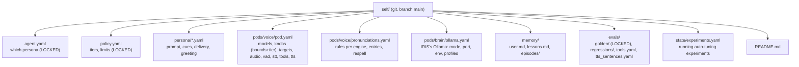
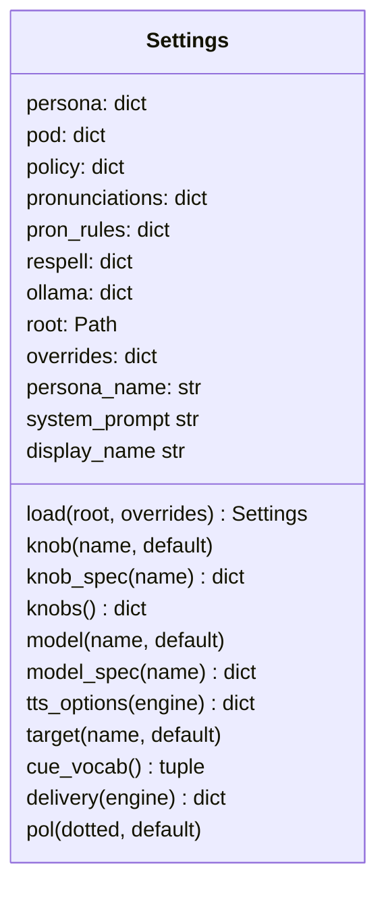
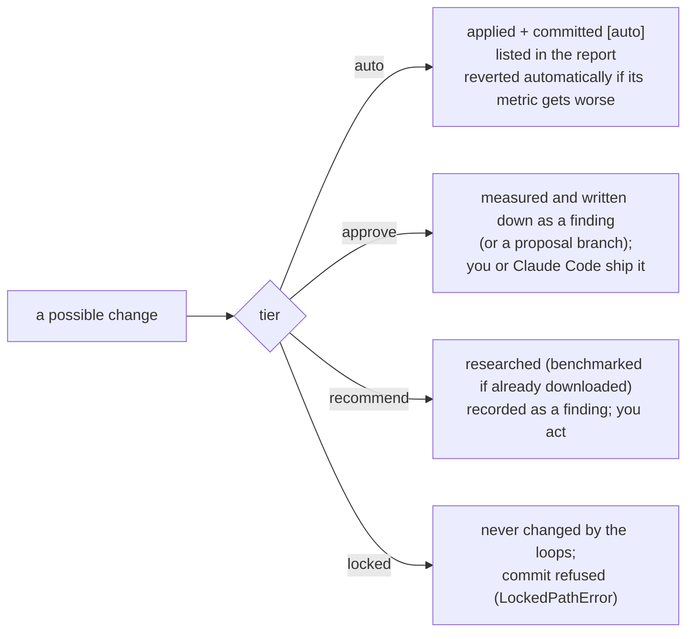
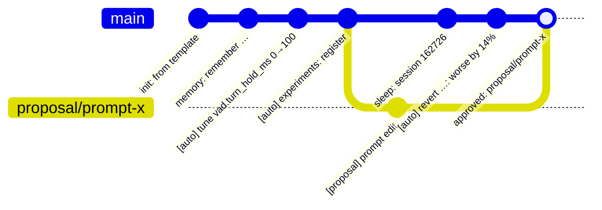

# 07 · The self store, settings and change tiers

Source: `iris/selfstore.py`, `iris/config.py`, `self_template/`. Decisions:
[ADR-0003](../adr/0003-body-and-self-split.md), [ADR-0004](../adr/0004-change-tiers-and-rollback.md).

The **self store** is everything that makes an agent *itself* and must survive a model swap or a move
to another machine. It is a local git repository per agent:
`~/.local/share/iris/agents/<agent>/self/` (default agent `iris`).

## 1. Layout

Note the two `state` folders: `self/state/experiments.yaml` is **in git** (experiments must be
reverted with the change they made); `agents/<agent>/state/` (lists, findings, bench, traits …) is
runtime data **outside** git. See [12 · Data and files](12-data-and-files.md).

## 2. How settings are read

* `Settings.load()` reads `agent.yaml` → persona name → `persona/<name>.yaml`, plus pod, policy,
  pronunciations and ollama files. Missing files read as `{}`.
* `overrides` hold live, in-memory values that win over the files (voice commands, a model switched
  from the web UI as `model.llm`, a candidate prompt `persona.system_prompt` inside the gate).
* `system_prompt` fills `{name}` and `{model}` so one persona works on any model.

## 3. Writing settings

| Writer | What | How |
|---|---|---|
| `config.set_value(section, name, value)` | one knob or model `value:` | rewrites only the `value:` inside that one-line entry, so comments and layout survive; validates min/max (and choices for knobs) |
| `iris set knob|model NAME VALUE` | you | `set_value` + a commit authored "You" |
| voice commands / web sliders | live voice knobs | `voicefx.apply` / `set_knob` + commit |
| tuner | auto-tier knobs, STT model | `set_value` + `[auto]` commit + experiment registration |
| `ollama_ctl.set_key/set_profile` | `ollama.yaml` | `iris ollama set|profile` only |
| `respell.teach/forget` | `pronunciations.yaml: respell` | voice command + commit |
| `teacher.tune_rules` | `pronunciations.yaml: rules` | night loop, `[auto]` commit |
| `Memory.apply/add_episode` | `memory/` | sleep loop or remember/forget, commit |
| `evals.write_regression` | `evals/regressions/` | sleep and judge stages, commit |

## 4. Tiers: what may change by itself

Defined in `policy.yaml: surfaces` and per knob in `pod.yaml` (`tier:`).

| Tier | Surfaces (template defaults) |
|---|---|
| auto | `memory/user.md`, `memory/lessons.md`, `memory/episodes/`, `evals/regressions/`, `pods/voice/pronunciations.yaml`, `auto` knobs (VAD, splitter, llm temperature/num_predict/history, stt beam/context), `models.stt` |
| approve | `persona/`, code, `pods/brain/ollama.yaml`, `approve` knobs (voice speed/volume/pitch/expressiveness/gap, `llm.num_ctx`, `vad.resume_window_ms`), `models.llm`, `models.tts_engine` |
| recommend | new models, packages, runtime versions |
| locked | `agent.yaml`, `policy.yaml`, `evals/golden/` (`locked_paths`) |

## 5. Commits, rollback and proposals

* `selfstore.commit(msg, files, auto)`: commits only the named files on `main`; auto commits are
  prefixed `[auto]` and authored "IRIS (auto)", yours "You". Any locked path in the change is reset and
  the commit refused. Git hooks and signing are disabled for these commits.
* `iris rollback [sha]`: reverts the latest (or given) `[auto]` commit. `iris log`: history.
* Proposals (`selfstore.propose`) are built in a temporary git worktree on a `proposal/<id>` branch, so
  the live store on `main` is untouched; `iris review | approve | reject`. (The current loops record
  findings rather than proposals; the mechanism remains for approve-tier changes.)
* Experiments are reverted with `git revert` and an `[auto] revert <sha>: <reason>` message.

## 6. Template and upgrades

`self_template/` in the repo is what a new agent starts from (`selfstore.init` copies it and commits
"init"). When the code adds things later, existing agents get them without losing their own edits:

| Mechanism | Adds |
|---|---|
| `selfstore._add_missing_from_template` (every start) | whole files the agent doesn't have yet |
| `config.sync_knobs` (session start) | knobs present in the template's pod.yaml but missing in the agent's |
| `config.sync_choices` (session start) | new model `choices` (e.g. GPU recognisers); never changes the chosen value |
| `voicefx.ensure_knobs` (session start) | voice knobs, and widened bounds (expressiveness 0..1 → 0..2) |

Existing values are never overwritten by an upgrade.

## 7. Multiple agents

`iris agent new <name> [--persona file.yaml]` creates another agent with its own self store, traces,
audio, state and reports; `iris --agent <name> talk` (or `IRIS_AGENT`) uses it. The code, the venvs and
the models are shared. Locks (`live`, `night`) are machine-wide because there is one GPU.

## 8. Safety rails (summary)

* Locked paths (`policy.yaml`, `agent.yaml`, `evals/golden/`) are refused at commit time.
* The gate's evaluator and the golden cases can't be edited by the loops, so they can't grade their own homework.
* Auto changes are small bounded steps with an automatic revert; one experiment per knob at a time.
* Approve-tier changes never reach the agent until a person ships them; the loops record findings instead of
  changing persona, models, Ollama settings or code.
* Memory is only written from your own conversations, never from web content.
* A live session holds a lock; background jobs wait for it or stop, they never fight over the GPU.
