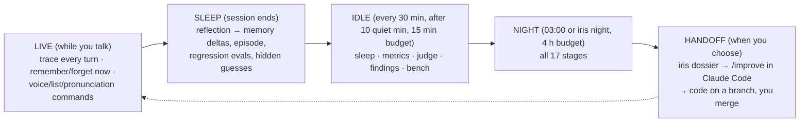
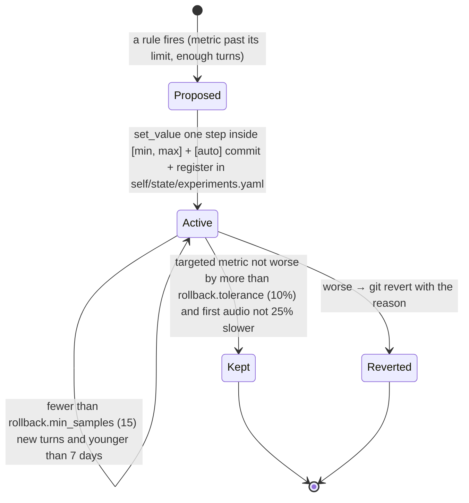
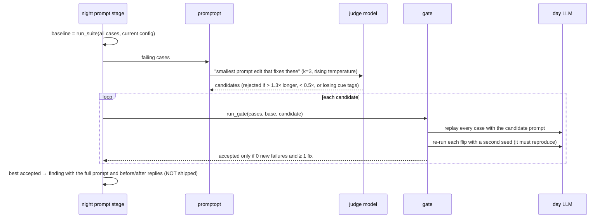
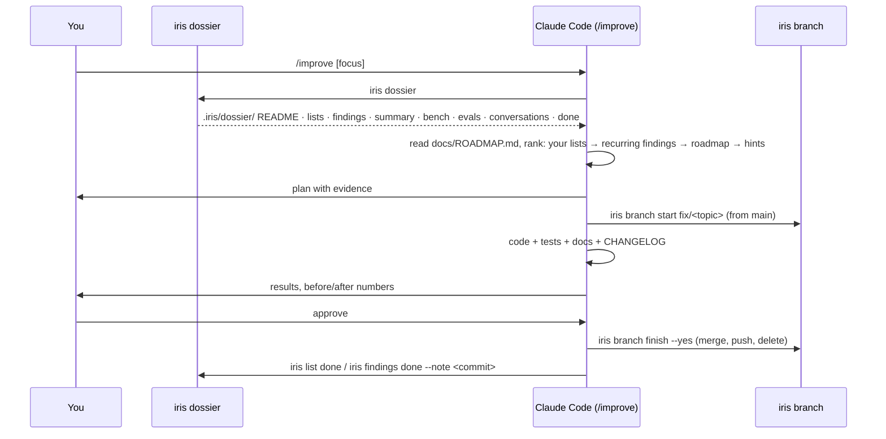
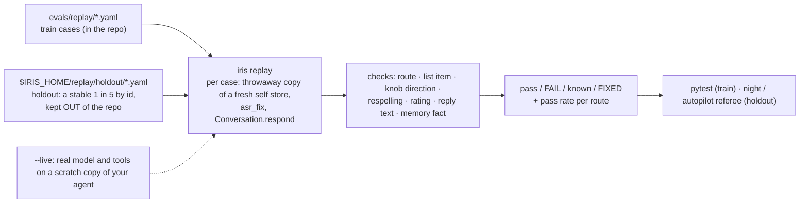
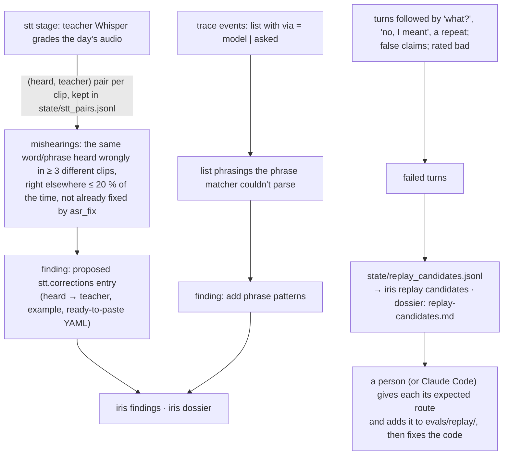

# 08 · Learning loops: sleep, idle, night, and the handoff to Claude Code

Source: `iris/improve/*.py`, `iris/evals.py`, `iris/metrics.py`. Decisions:
[ADR-0004](../adr/0004-change-tiers-and-rollback.md), [ADR-0010](../adr/0010-no-regression-eval-gate.md),
[ADR-0011](../adr/0011-local-loops-measure-claude-code-engineers.md).

## 1. Four time scales



Everything yields to you: starting `iris talk` stops a running job, which saves what it has
([09](09-jobs-and-processes.md)).

## 2. The night stages

```mermaid
flowchart TD
    C[cleanup<br/>delete audio over 14 days, traces over 365] --> SL[sleep<br/>reflect on unreflected sessions]
    SL --> ME[metrics<br/>from traces since the last run]
    ME --> STT[stt<br/>teacher Whisper grades the day's audio and every installed recogniser]
    STT --> TTS[tts<br/>speech round trips per voice, A/B clips, pronunciation-rule tuning]
    TTS --> JU[judge<br/>bigger LLM scores replies; poor ones → regression evals]
    JU --> EX[experiments<br/>keep or revert earlier auto changes]
    EX --> TU[tune<br/>new bounded knob steps, STT model choice]
    TU --> EV[evals<br/>full suite with the current config]
    EV --> PR[prompt<br/>prompt edits through the gate → finding]
    PR --> VO[voice<br/>your A/B votes → finding]
    VO --> SC[scout<br/>packages, Ollama, trending models, local LLM benchmarks]
    SC --> BE[bench<br/>latency, tool choice, Ollama server settings]
    BE --> FI[findings<br/>metrics vs targets, regressions, errors, slow stages]
    FI --> MI[mine<br/>recurring mishearings, list phrasings, failed turns → proposals only]
    MI --> SU[suggest<br/>the judge's own ideas as low-confidence hints]
    SU --> RE[report<br/>morning report, desktop notification]
```



Each stage is isolated (`Night.stage`): an exception is recorded and the next stage runs. A stage is
skipped (with the reason recorded) when: you started talking, jobs are paused, the time budget is used,
or it needs the LLM and Ollama/the model isn't available. `iris night --only stt,tts --skip report`
runs a subset; partial runs still write a report unless `report` is skipped. Results go to
`agents/<agent>/night/DATE/results.json` (idle runs: `idle-HHMM.json`).

The idle subset is `sleep, metrics, judge, findings, bench` (bench without the Ollama-config comparison).

## 3. Bounded auto-tuning with automatic rollback



Rules (`tuner.RULES`), one step per knob per night, at most 3 changes, never a knob with an active
experiment:

| Knob | Direction | When | Targets |
|---|---|---|---|
| `vad.turn_hold_ms` | + | Smart Turn on and `premature_eos_rate` > max(0.05, target 0.03) | `premature_eos_rate` |
| `vad.turn_hold_ms` | − | cut-offs ≤ 1 % and `trailing_wait_ms_p50` ≥ 500 | `trailing_wait_ms_p50` |
| `vad.silence_ms` | ± | same two rules when Smart Turn is off | same |
| `vad.threshold_db` | + | `false_trigger_rate` > 0.10 | `false_trigger_rate` |
| `splitter.min_chunk_chars` | + / − | underruns > 0.3 per turn / underruns < 0.05 and first audio over target | underruns / `first_audio_p50` |
| `llm.num_predict` | + / − | truncated > 10 % / truncated < 3 % and late barge-ins > 15 % or judge brevity < 3.5 | `truncated_rate` / `late_barge_in_rate` |
| `llm.temperature` | − | format violations > 0.3 per turn | `format_violations_per_turn` |
| `llm.history_turns` | − | prompt eval p50 > 0.8 s | `prompt_eval_p50` |
| `stt.beam_size` | + | `stt_wer` over target and STT has time to spare | `stt_wer` |

**STT model choice** (`tuner.choose_stt`): from the teacher grading, take the fastest installed
recogniser whose WER is within 2 points of the best and whose median time is ≤ 0.6 s; registered as an
experiment like a knob.

## 4. Grading with bigger models ("teachers")

* **STT** (`teacher.grade_stt`): large-v3-turbo (beam 5) re-transcribes up to 120 recent recordings;
  that is the reference for the live transcripts (`stt_wer`) and for every candidate in
  `models.stt.choices` (`@gpu` candidates only if the GPU has room). Spot checks with > 25 % WER go into
  the report.
* **Voice round trip** (`teacher.roundtrip`): each voice speaks fixed texts (`evals/tts_sentences.yaml`,
  grouped and rotated nightly) plus recent real replies; Whisper transcribes them back; lost words =
  intelligibility errors (`tts_roundtrip_wer`). Up to `night.rate_clips` (8) clips per voice are kept for
  `iris rate`, the blind A/B listening test; your votes (`state/ratings.jsonl`) become a finding when one
  voice leads by 3.
* **Pronunciation rules** (`teacher.tune_rules`): each number/currency/maths rule is toggled per engine
  and kept only if the round trip on the numbers group improves.
* **Judge** (`judge.Judge`, `night.judge_model` qwen3:8b, falls back to the day model): scores the last
  60 replies for relevance, brevity, honesty and persona (1–5). Replies with overall ≤ 2.5 or honesty ≤ 2
  become regression evals. Calibrate it against your own ratings: the report shows both.

## 5. Evals and the no-regression gate



* **Cases:** `evals/golden/*.yaml` (yours, locked) and `evals/regressions/*.yaml` (harvested). A case
  is `{id, user, history?, checks}`; checks: `max_words`, `min_words`, `no_markdown`, `no_emoji`,
  `valid_cues`, `contains_any`, `not_contains`, `asks_question`, `judge: "rubric"` (judge must give 4–5).
* **Why prompt edits are recorded, not shipped:** a small model's prompt edits overfit a small eval set;
  a person or Claude Code decides ([ADR-0011](../adr/0011-local-loops-measure-claude-code-engineers.md)).
* The gate cannot edit its own evaluator or the golden cases, so the loops can't grade their own homework.

## 6. Benchmarks and the scout

* **bench** (`improve/bench.py`, every night and idle): fixed prompt per model and context size (cold
  load, time to first token, prompt eval, tokens/s, VRAM); reasoning-leak probe; tool-choice accuracy on
  `evals/tools.yaml` (tools are not executed); at night, the same measurement on throwaway Ollama
  instances with flash attention and `q8_0` KV cache. Rows → `state/bench.jsonl`; anything notable →
  findings. The web UI's MODELS tab can run the same test on demand.
* **scout** (`improve/scout.py`): PyPI versions of the packages in use, the latest Ollama release,
  trending Hugging Face models filtered to what fits the GPU, and eval-suite benchmarks of models you
  already pulled (`scout.ollama_candidates`). It never downloads (`scout.allow_downloads_gb: 0`).

## 7. Findings

A finding is something the loops noticed, with evidence (`state/findings.jsonl`):

```json
{"id": 12, "area": "perf", "kind": "bottleneck", "title": "First sound takes 2.19s (target 1.5s); biggest part: first_chunk_p50",
 "evidence": ["stage medians: {...}"], "source": "findings", "confidence": "medium",
 "count": 3, "status": "open", "fingerprint": "a1b2c3d4e5f6", "ts": 0, "last_seen": 0, "data": {}}
```

* `area`: perf · hearing · turn-taking · voice · intelligence · tools · memory · architecture · models.
* `kind`: metric-regression · bottleneck · capability-gap · failure-cluster · suggestion · recommendation · benchmark.
* The same finding again (same fingerprint: area + kind + title with numbers masked) raises `count`
  instead of duplicating, so recurring problems rank first. `source: local-model` ideas rank last
  (hints from a small model).
* Sources: night `findings` stage, prompt gate, voice votes, scout, bench, the live pipeline (false
  claims, leaks).
* Close with `iris findings done F3 --note <commit>` or `drop` with a reason.

## 8. The handoff: dossier → Claude Code



The dossier contains transcripts (never audio) and is only read by a session you start; IRIS itself
sends nothing anywhere. `.claude/commands/improve.md` is the procedure.

## 9. The morning report

`report.write` produces `agents/<agent>/reports/DATE.md` and `DATE.html`: key metrics with trends vs the
last night, what changed by itself (experiments kept/reverted, new regressions, memory changes), findings,
your lists, voice clips to rate, and what failed. `iris report --open`.

## 10. Later: population-based search

Evolutionary search (OpenEvolve, Darwin Gödel Machine) is deliberately left for later and only for narrow pieces
with a fast automatic score (for example the end-of-turn function or the splitter, scored by replayed traces). Its
winner would go through the same gate and approval path as everything else. See also
[../plans/smarter-through-code.md](../plans/smarter-through-code.md).

## 11. The replay benchmark

Source: `iris/replay.py`, `evals/replay/*.yaml`, `tests/test_replay.py`. Decision:
[ADR-0032](../adr/0032-replay-benchmark-as-the-gate.md).

The eval suite above grades *what the model says*. The replay benchmark grades *what the code does with what you
said*: which path answers (`route`), what lands on a list, which knob moves, whether a pronunciation is wrongly
taught. Every case is a real utterance from your sessions (redacted by hand) or a deliberate near-miss, plus what must
happen:

```yaml
- id: real-pron-cuban-wrong
  said: "The word Cuban is pronounced wrong."
  expect: {route: model, no_respell: true}      # a complaint, not a lesson
```



* **Routes:** `list | voice | pronounce | rating | garble | fastpath:<intent> | lookup:<intent> | search | model`. Every
  turn record and every returned `TurnResult` carries it, so the benchmark, the metrics (`code_handled_rate`,
  `route_counts`) and a future router all read the same thing.
* **Offline (default, in the test suite, ~3 s):** a fake LLM, `IRIS_OFFLINE=1`, a fresh copy of a template self store per case,
  nothing written to your home. It scores everything code decides. **Live (`--live`, uses the GPU):** the real model and
  tools on a scratch copy of your agent; adds reply checks (`no_false_claim`, `max_words`).
* **`known_failing: true`** marks a real failure that is an improvement target. It is reported, not an error; the moment
  it passes, the test says so and the flag must be removed. The first baseline (2026-10-18): 177 cases, 174 pass, 3 known
  failures ("expressiveness up to the max", "stick like this, don't change", "slightly, slightly deeper" inside a long request).
* **Train / holdout:** cases whose id hashes into 1 in 5 are held out and live outside the repo, so whoever improves the
  code (a person or the autopilot) can't tune to them; the night loop and the autopilot's referee score them. Add cases by
  editing the YAML source and re-running `iris replay split SRC` (adding a case never reshuffles the others).
* **Live baseline (2026-10-18, real gemma4 vision-only + tools, 5 min):** 177 cases, 174 pass, the same 3 known failures; where the
  real model decides it can differ from offline (it searches by itself on open questions, which still counts as `model`; it resolves
  "add that to the list" where the fake model has to ask).
* **What it already found** (at its first run): "the train was too fast" and "my cat is too loud at night" changed the
  voice settings; "The word Cuban is pronounced wrong" would have taught "Cuban" the pronunciation "wrong". Both fixed.
* **Adding a case:** when something goes wrong in a real session, add the phrase with what should have happened
  (redact names), run `iris replay`, see it fail, fix the code, see it pass.

## 12. Rule mining

Source: `iris/improve/mine.py` (night stage `mine`, after `findings`), `iris replay candidates`. Decision:
[ADR-0033](../adr/0033-rule-mining-proposes-never-applies.md).

The night loop reads your own data for things that recur, and **writes proposals, never changes**:



* **Pairs come for free** from the STT grading stage (which already decodes every clip with the big model); only the worst
  8 used to be kept, now every pair is (newest 2000, one per recording).
* **Why ≥ 3 clips and "right elsewhere":** a replacement rewrites every occurrence; seen on your 202 real clips,
  recurring mishearings are rare (none reached 3 clips; the nearest was 2 and is noise) so the stage mostly says "nothing yet"
  until months of data accumulate. A heard phrase that the big model *agrees with* in more than 20 % of its uses is never proposed.
* **How list requests were understood** is now on the `list` trace event (`via`: `phrase` matcher, `model` extracted the item,
  `asked` it had to ask, `awaited` the answer to its question); `model`/`asked` ones are the phrasings to add.
* **Closing the loop:** `iris replay candidates` lists the turns that went wrong; label one, add it to `evals/replay/`
  ([11](#11-the-replay-benchmark)), then `iris replay candidates done <id>` (or `drop <id>`).
