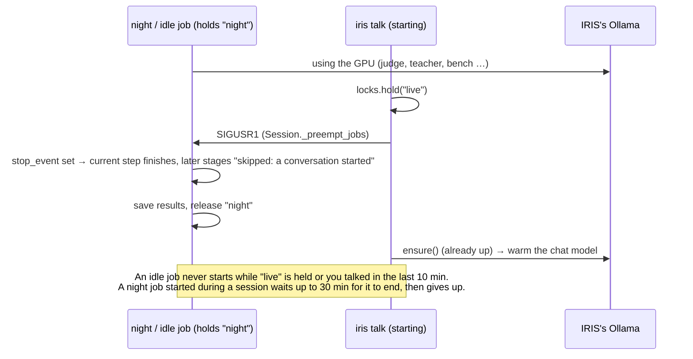
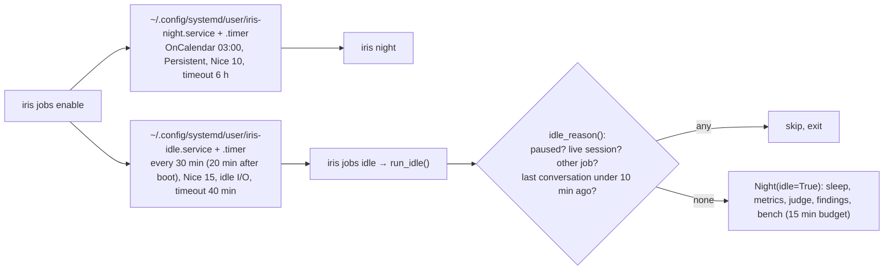
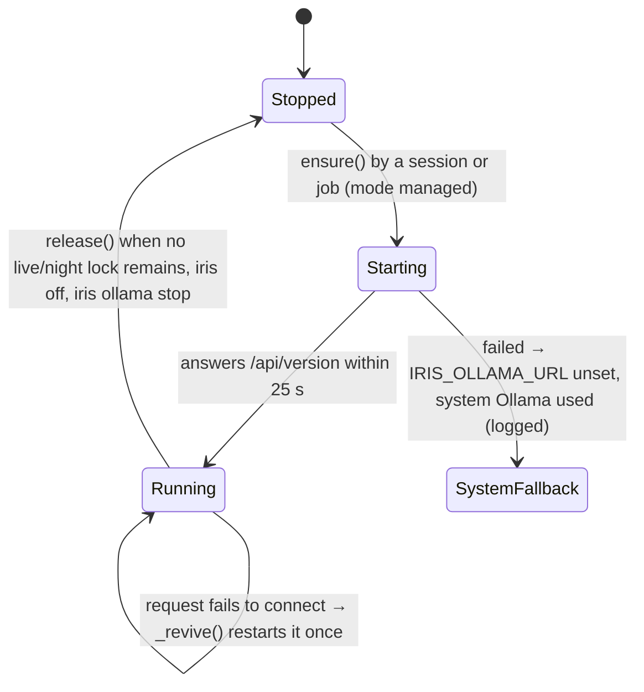

# 09 · Jobs, processes, locks and controls

Source: `iris/jobs.py`, `iris/locks.py`, `iris/ollama_ctl.py`, `iris/talk.py` (socket, preemption),
`iris/cli.py` (`off`), `scripts/systemd/`. Decision:
[ADR-0023](../adr/0023-background-jobs-and-preemption.md).

## 1. Locks: one GPU, one owner at a time

Two PID-file locks in `IRIS_HOME` (machine-wide, not per agent, because there is one GPU):

| Lock | File | Held by |
|---|---|---|
| `live` | `~/.local/share/iris/live.lock` | a running `iris talk` / `chat` / `ui` |
| `night` | `~/.local/share/iris/night.lock` | a running night or idle job |

`locks.hold(name)` refuses if a living process already holds it; `locks.holder(name)` returns that PID
(stale PIDs are ignored).

## 2. Who preempts whom

## 3. Background schedules (only after `iris jobs enable`)

Timers are never installed silently: only `iris jobs enable` (or `./setup.sh --timer`) writes the units
(the only thing IRIS writes outside the repo and its data folder). `iris jobs disable` removes them.

## 4. Controls

| Command | Effect |
|---|---|
| `iris jobs status` | running PID, paused (until), live session, last night/idle run, timer states, why idle is blocked |
| `iris jobs pause [--for 2h]` | nothing starts until resumed or the time is up (`state/jobs.pause.json`); also stops a running job |
| `iris jobs resume` | removes the pause |
| `iris jobs stop` | SIGUSR1, wait up to 30 s, then SIGTERM |
| `iris jobs idle [--force]` | run the idle job now |
| `iris off [--pause 2h|forever]` | stop everything IRIS runs: the session (via its socket), jobs, IRIS's Ollama; optionally pause jobs |
| `iris ollama status|start|stop|restart` | IRIS's Ollama instance |
| `iris ptt down|up|toggle|interrupt|good|bad|quit` | control a running session from a hotkey |

## 5. The session control socket

A running session listens on a unix datagram socket `$XDG_RUNTIME_DIR/iris-<agent>.sock` (mode 0600).
Messages: `down`, `up`, `toggle` (push-to-talk), `interrupt`, `good`, `bad` (rate the last reply),
`quit`. `scripts/hyprland-ptt.conf` binds SUPER+F12 to `iris ptt down/up`.

## 6. IRIS's Ollama lifecycle

It runs as the transient unit `iris-ollama-11435` (`systemd-run --user --collect`), with only
`OLLAMA_*`, CUDA and basic environment variables passed through, logging to
`~/.local/share/iris/logs/ollama-iris.log`.

## 7. Logs

| File (`~/.local/share/iris/logs/`) | Written by |
|---|---|
| `night-<agent>.log`, `idle-<agent>.log` | night / idle job |
| `worker-kokoro.log`, `worker-chatterbox.log` | TTS workers (stderr) |
| `ollama-iris.log` | IRIS's Ollama |
| `ollama-bench.log` | throwaway benchmark instances |

Setup logs are in the repo's `logs/` (`setup.log`, `tonight.log`; gitignored).
