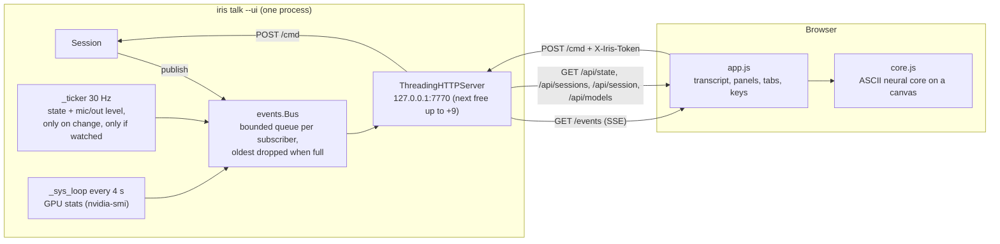

# 10 · Web UI

Source: `iris/web/server.py`, `iris/web/static/{index.html, app.js, core.js, style.css}`,
`iris/events.py`, `iris/talk.py` (`Session.command`, `probe`, `_ticker`). Decision:
[ADR-0021](../adr/0021-web-ui-stdlib-sse.md).

`iris talk --ui` (or `iris ui`) runs the normal session plus a local web server and opens the page.
`iris eye` previews the page with no models loaded (it animates itself).

## 1. Architecture

## 2. Security

* Bound to 127.0.0.1 only; `Host` must be `127.0.0.1:<port>` or `localhost:<port>`.
* Every API request needs the per-session random token (in the URL IRIS opens; `X-Iris-Token` header
  for POST), compared in constant time.
* POST requires a same-origin (or absent) `Origin`; bodies over 64 KB are refused.
* Static files are sent with a strict Content-Security-Policy (`default-src 'self'`, no inline scripts),
  `nosniff`, `no-referrer`, `no-store`.

## 3. Routes

| Route | Returns |
|---|---|
| `GET /`, `/app.js`, `/core.js`, `/style.css` | the page |
| `GET /events?token=` | Server-Sent Events: a `hello`, then bus events (`: ping` every 10 s) |
| `GET /api/state?token=` | snapshot: session info, knobs with bounds, targets, open lists, top findings, today's metrics, jobs, Ollama status |
| `GET /api/sessions?days=` | one row per past conversation (`trace.session_index`) |
| `GET /api/session?id=` | that conversation's turn summaries |
| `GET /api/models` | installed models with their latest benchmark numbers and traits |
| `GET /report?token=` | the latest morning report (HTML) |
| `POST /cmd` | `Session.command(json)` |

## 4. Events (Session → page)

| type | payload | meaning |
|---|---|---|
| `hello` | `demo` | connected |
| `state` | `state` (booting, idle, hearing, thinking, speaking, asleep), `mic`, `out` | what the core shows |
| `hearing` | — | speech started (hands-free) |
| `user` | `text`, `stt_s` or `typed` | what you said |
| `delta` | `text` | raw LLM text as it streams (token counter) |
| `say` | `text` | a sanitized chunk queued to speak |
| `spoken` | `text`, `dur` | the chunk now playing (live captions) |
| `tool` | `name`, `label` | a tool is running |
| `interrupt` | `reason` | reply cancelled |
| `turn` | turn summary | finished turn with the latency breakdown |
| `rated` | `value`, `turn` | a rating was recorded |
| `ptt` | `recording` | push-to-talk state |
| `wake` | — | wake word heard |
| `note` | `text` | a short system line ("didn't catch that") |
| `info` | session info | mode/models changed |
| `lists`, `models` | — | refresh that panel |
| `sys` | `gpu` | GPU name, VRAM used/total, utilisation, temperature |
| `bye` | — | the session ended |

## 5. Commands (page → Session)

`text`, `interrupt`, `ptt` (`action`), `rate` (`value`, `turn`, `note`), `mode` (`vad`/`ptt`), `wake`
(`on`), `knob` (`name`, `value`), `list_add` / `list_done` / `list_drop`, `jobs` (`pause`/`resume`/
`stop`, `for`), `model` (switch the LLM now and save it), `bench_model` (measure one model in the
background), `quit`.

## 6. The page

* **Dialogue:** your words, IRIS's reply (dim while generated, bright as spoken), one-click ratings, the
  per-turn latency waterfall (STT / LLM / generation / TTS / playback) against the target.
* **Tabs:** LISTS · HISTORY (every past conversation) · MODELS (compare, switch, test) · FINDINGS ·
  VOICE (sliders for the live voice knobs) · JOBS · KEYS, plus REPORT.
* **Keys:** Space/Enter talk or interrupt, `t` type, `m` hands-free/push-to-talk, `+ = -` rate, `f` full view.
* **Core** (`core.js`): a JARVIS-style ASCII neural sphere on a canvas: depth-shaded glyph cloud with
  synapses and travelling signals, an iris that looks around, HUD rings with a voice waveform and
  spectrum. Gruvbox colours per state, cross-faded; 30 fps cap, paused when the tab is hidden; drag to
  spin, scroll to zoom. FULL VIEW (`f` or double-click) keeps only the core and live captions.
* Open it as an app window with `ui: {browser_cmd: "chromium --app={url}"}` in pod.yaml.
