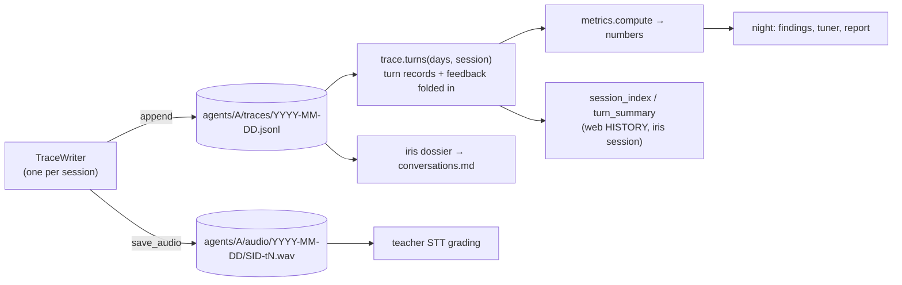

# 11 · Observability: traces, metrics, reports

Source: `iris/trace.py`, `iris/metrics.py`, `iris/util.py`, `iris/cli.py` (`session`, `metrics`),
`iris/improve/insights.py`, `iris/improve/report.py`.

Traces are the raw material of every improvement: **if it isn't in a trace it can't be measured, and
if it can't be measured the loops can't improve it.** Any new behaviour should write what it did.

## 1. Data flow

## 2. Record types (`schema: trace/v1`)

Every line has `schema`, `type`, `session`, `ts`.

| type | written by | extra fields |
|---|---|---|
| `turn` | `Conversation.respond`, `Session._handle_audio` (non-turns) | see the turn record below |
| `session_start` | `Session.boot` | `mode`, `agent`, `persona`, `config{self, knobs}`, `models{llm, stt, tts}` |
| `session_end` | `Session.shutdown` | `turns` |
| `feedback` | ratings (voice, `+ = -`, hotkey, UI) | `turn`, `value` (good, ok, bad), `source`, `note` |
| `tool` | `Session._on_tool` | `name`, `args` |
| `list` | list commands | `text`, `said` |
| `pronunciation` | pronunciation commands | `text`, `said` |
| `voice_feedback` | voice commands | `text`, `changes`, `said` |
| `garble_ask` / `garble_confirmed` / `garble_rejected` | garble guard | `text`, `logprob` |
| `model_fallback` | leak guard switching models | `frm`, `to`, `reason` |
| `model_switch` | web UI MODELS tab | `frm`, `to`, `source` |
| `stt_fallback` | the GPU recogniser failed mid-session (CUDA error) | `frm`, `to`, `error` |

### The turn record

| Field | Meaning |
|---|---|
| `turn` | number within the session; `null` for utterances that didn't become turns |
| `mode` | `ptt`, `vad` or `text` |
| `audio_in` | recording path relative to the agent's audio dir |
| `user_text` | what STT heard (after `asr_fix`, wake word removed) or what was typed |
| `stt` | `model, secs, audio_s, avg_logprob, no_speech_prob, hallucination` |
| `endpoint` | `method, speech_ms, trailing_silence_ms, merged_after_resume, reason (silence, smart_turn, turn_timeout, max_length), turn_prob, segments[], hold_ms` |
| `llm` | `model, ttft_s, total_s, load_s, prompt_tokens, prompt_eval_s, tokens, tok_s, done_reason, error` |
| `reply_raw` / `reply_spoken` | everything the model wrote / what reached the speaker |
| `chunks` | number of speakable chunks |
| `sanitized` / `invalid_tags` | counts removed: markdown, emoji, stage, invalid_cues, think, urls |
| `tts` | `engine, chunks, first_chunk_gen_s, gen_s, audio_s, error` |
| `timing` | seconds from end of speech: `stt_done, first_token, first_chunk, first_chunk_synth, first_audio, done, cut_at_length` |
| `playback` | `underruns, gap_max_ms, played_s` |
| `barge_in` | `{at_s, fraction}` when you interrupted |
| `cancelled` | why the reply was abandoned (`resume`, `quit`, `leak`) |
| `error` | LLM error text |
| `tools` | `[{name, args, ok, secs, chars}]` |
| `fastpath` | `time, date, calc, units, currency, timezone, wikipedia, weather` when answered by code |
| `forced` | `search` (explicit request) or `recovered-search` (announced but not called) |
| `false_claim` | kinds: `search, list, voice, pronounce, number` |
| `false_trigger` / `filler` | non-turns: noise or only "um" |
| `config` | `self` (self-store sha), `knobs`, `persona`, `models` at that moment |

## 3. Metrics (`metrics.compute`)

Lower is better unless marked ↑.

| Group | Metric | Definition |
|---|---|---|
| speed | `first_audio_p50` / `p90` | end of speech → first sound |
| | `stt_s_p50`, `llm_ttft_p50`, `first_chunk_p50`, `prompt_eval_p50` | stage medians |
| | `llm_tok_s` ↑ | mean tokens/s |
| turn-taking | `premature_eos_rate` | hands-free turns that were merged after a cut-off |
| | `trailing_wait_ms_p50` | silence waited after you finished |
| | `smart_turn_end_rate`, `turn_timeout_rate` | how turns ended |
| | `false_trigger_rate` | noise taken for speech (of voice utterances) |
| hearing | `stt_hallucination_rate`, `repeat_rate`, `clarify_rate` | invented text; you repeated; you said "what?" |
| | `stt_wer` | vs the teacher model (night) |
| thinking | `reply_words_mean`, `format_violations_per_turn`, `truncated_rate`, `correction_rate`, `errors` | |
| | `judge_mean` ↑, `judge_brevity`, `judge_honesty`, `eval_pass_rate` | night |
| speaking | `underruns_per_turn`, `tts_rtf` ↑, `tts_roundtrip_wer` | |
| interaction | `barge_in_rate`, `late_barge_in_rate` (after 60 % of a reply), `feedback_good` ↑, `feedback_bad` | |

Targets live in pod.yaml `targets:` (`first_audio_s` 1.5, `premature_eos_rate` 0.03, `stt_wer` 0.10,
`reply_words` 45). `metrics.worse_by` gives the relative degradation used by rollback.

## 4. Looking at the data

| Command | Shows |
|---|---|
| `iris session [id]` | one conversation: per-turn first sound, STT model and time, ttft, how the turn ended, flags (false claim, cut-off, fast path, interrupted, rated) and a summary |
| `iris metrics [--days N]` | the metric dictionary as JSON |
| `iris findings [--area X] [--all]` | findings, most recurring first |
| `iris report [--open]` | the latest morning report |
| `iris dossier` | everything above as markdown for Claude Code |
| `iris status` | configured models, pending items, Ollama, jobs |
| web UI HISTORY tab | every past conversation, turn by turn |

## 5. Privacy and retention

* Audio is recorded only if `privacy.record_audio` (needed for teacher grading) and deleted after
  `privacy.keep_audio_days` (14) by the night `cleanup` stage; traces after `keep_traces_days` (365).
* Speech without the wake word (when it is on) is dropped and its audio deleted at once.
* Nothing in traces, audio or state is sent anywhere by IRIS.
