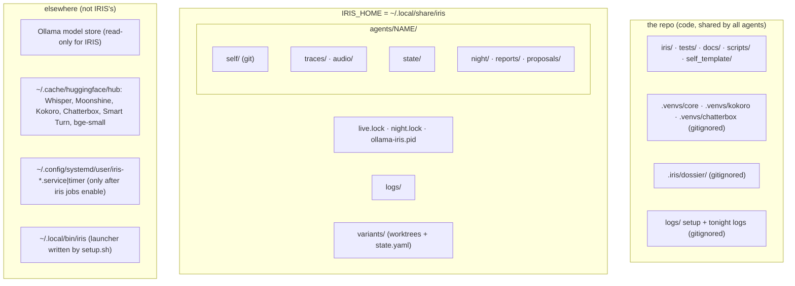

# 12 · Data and files: everything on disk

Source: `iris/paths.py` and the modules that own each file.

## 1. The three places

## 2. Agent folder in detail

| Path (under `agents/NAME/`) | Format | Owner | In git |
|---|---|---|---|
| `self/` | see [07](07-self-store.md) | everything that changes the agent | **yes** (own repo) |
| `self/state/experiments.yaml` | `{active: [...], history: [...]}` | `improve/tuner.py` | yes |
| `traces/YYYY-MM-DD.jsonl` | trace/v1 lines | `trace.py` | no |
| `audio/YYYY-MM-DD/SID-tN.wav` | 16 kHz PCM16; `-fN` false triggers, `-uN` fillers | `trace.py`, `talk.py` | no |
| `state/lists.jsonl` | list items | `lists.py` | no |
| `state/observations.jsonl` | `{id, kind (request, gap), text, session, ts, status (new, promoted, dismissed), source}` | `observations.py` | no |
| `state/findings.jsonl` | findings | `improve/insights.py` | no |
| `state/bench.jsonl` | `{ts, kind (llm, tools, leak, ollama), …}` | `improve/bench.py`, web MODELS | no |
| `state/model_traits.json` | `{model: {leaks, checked}}` | `pipeline.py` | no |
| `state/vram.json` | `{engine: MB, "llm:model": MB}` learned sizes | `vram.py` | no |
| `state/stt_pairs.jsonl` | `{audio, heard, teacher, ts}`: what was heard vs the big model's reading, newest 2000 | `improve/mine.py` | no |
| `state/replay_candidates.jsonl` | turns that went wrong, waiting to become replay cases `{id, said, why, route, reply, session, turn, status}` | `improve/mine.py` | no |
| `state/ratings.jsonl` | `iris rate` votes `{ts, pair, winner, clip}` | `improve/review.py` | no |
| `state/night.json` / `idle.json` | `{last_run_ts, last_finished, metrics}` | `improve/night.py` | no |
| `state/sleep.json` | `{reflected: [session ids]}` | `improve/sleep.py` | no |
| `state/scout.json` | `{seen_models, last_run}` | `improve/scout.py` | no |
| `state/jobs.pause.json` | `{since, until}` | `jobs.py` | no |
| `state/requests.jsonl`, `escalation.json` | legacy (older versions), safe to delete | — | no |
| `../replay/holdout/*.yaml` (under IRIS_HOME, not per agent) | held-out replay cases, kept out of the repo on purpose | `iris replay split` | no |
| `night/YYYY-MM-DD/` | `results.json`, `idle-HHMM.json`, `judge.json`, `clips/`, `prompt-candidate-*.txt` | night loop | no |
| `reports/YYYY-MM-DD.md` + `.html` | morning report | `improve/report.py` | no |
| `proposals/*.json` | evidence for proposal branches | `selfstore`, `review` | no |

## 3. IRIS_HOME level

| Path | What |
|---|---|
| `live.lock`, `night.lock` | PID locks (machine-wide) |
| `ollama-iris.pid` | main PID of IRIS's Ollama |
| `logs/` | night/idle, worker and Ollama logs ([09](09-jobs-and-processes.md)) |
| `variants/<name>/` | git worktrees of auto variants; `variants/state.yaml` (blocked, last sync) ([BRANCHING](../BRANCHING.md)) |

| `autopilot/` | the autopilot supervisor's state ([15](15-autopilot.md)): `config.yaml`, `freellmapi.key` (0600), `state.yaml` (baseline, nights), `work/` (the worker's clone and venv), `runner/` (pinned scorer), `codex/` (worker's Codex config), `home/` (scratch home), `log/` (outbound log, one jsonl per night), `digests/`, `STOP` |

`$XDG_RUNTIME_DIR/iris-<agent>.sock` is the session control socket.

## 4. What to back up

| Priority | What | Why |
|---|---|---|
| must | `agents/NAME/self/` | persona, memory, settings, evals: the agent itself (a git repo: `git bundle` it) |
| should | `agents/NAME/state/` | your lists, findings, benchmarks, learned sizes |
| nice | `agents/NAME/traces/` | history; future improvements are mined from it |
| optional | `agents/NAME/audio/` | only the last 14 days; re-grading |
| no | `.venvs/`, model caches | re-created by `./setup.sh` |

See [REBUILD.md](../REBUILD.md).
