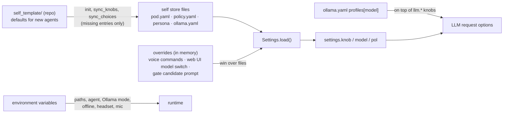

# 13 · Configuration reference

Every setting, where it lives, its default, and who may change it. All files are in the agent's self
store (`~/.local/share/iris/agents/NAME/self/`); new agents start from `self_template/`. Change them with
the CLI so the change is committed and reversible: `iris set knob|model NAME VALUE`,
`iris ollama set|profile …`, `iris persona …` ([07](07-self-store.md)).

## Where a value comes from

`tests/test_docs.py` checks that every knob, every pod.yaml and policy.yaml section and every
environment variable the code reads is listed here.

## 1. `pods/voice/pod.yaml`

### `models`

| Key | Default | Tier | Meaning |
|---|---|---|---|
| `llm` | `qwen3:4b` (template; the live agent uses `gemma4:e4b-it-qat-vision`, gemma4 without its audio encoder) | approve | the Ollama model for conversation |
| `llm_fallback` | unset | — | first choice when the leak guard switches models |
| `stt` | `base.en` (template; live `small.en@gpu`) | auto | speech recogniser; `choices` lists what the night loop compares; `@gpu` suffix = on the GPU |
| `tts_engine` | `kokoro` | approve | `kokoro` or `chatterbox` (`tone` for tests) |

### `knobs` (bounded; `auto` ones are tuned overnight with rollback)

| Knob | Default | Range | Step | Tier | Effect |
|---|---|---|---|---|---|
| `vad.silence_ms` | 700 | 350 – 1400 | 50 | auto | end of turn after this silence (when Smart Turn is off) |
| `vad.threshold_db` | 12 | 6 – 24 | 1 | auto | energy VAD: dB above the noise floor that counts as speech |
| `vad.min_speech_ms` | 250 | 100 – 600 | 50 | auto | shortest speech that starts an utterance |
| `vad.turn_hold_ms` | 0 | 0 – 800 | 100 | auto | extra silence before Smart Turn may end a turn |
| `vad.resume_window_ms` | 1000 | 400 – 2000 | 100 | approve | speech resuming this fast is merged with the previous utterance |
| `vad.barge_in_db` | 6 | 3 – 15 | 1 | auto | headset: extra loudness needed to interrupt IRIS |
| `stt.context` | 1 | 0 – 1 | 1 | auto | give Whisper the conversation as a hint |
| `stt.beam_size` | 1 | 1 – 5 | 1 | auto | Whisper beam search width |
| `llm.temperature` | 0.7 | 0.2 – 1.0 | 0.05 | auto | sampling temperature |
| `llm.num_predict` | 400 | 80 – 800 | 20 | auto | max tokens per reply (cut at a sentence + offer to continue) |
| `llm.num_ctx` | 4096 | 2048 – 8192 | 1024 | approve | context window (changing it reloads the model) |
| `llm.history_turns` | 12 | 4 – 24 | 2 | auto | exchanges kept in the prompt (trimmed in blocks) |
| `splitter.min_chunk_chars` | 60 | 20 – 160 | 10 | auto | later sentences are merged to at least this length |
| `splitter.first_clause_chars` | 30 | 0 – 90 | 10 | auto | speak a long first sentence from its first clause |
| `splitter.first_phrase_words` | 10 | 0 – 20 | 1 | auto | … or from a phrase boundary after this many words (0 = off) |
| `tts.speed` | 1.0 | 0.85 – 1.2 | 0.05 | approve | speaking rate |
| `tts.volume_db` | 0 | −12 – 12 | 2 | approve | output gain (limited, never clips) |
| `tts.pitch_semitones` | 0 | −4 – 4 | 1 | approve | pitch shift, duration kept |
| `tts.expressiveness` | 0.8 | 0 – 2 | 0.25 | approve | wider tone speeds, ±3 % pace variety, longer breaths; Chatterbox exaggeration/temperature |
| `tts.sentence_gap_ms` | 0 | 0 – 800 | 100 | approve | extra silence after each chunk |

### Other sections

| Section | Keys (default) | Read by |
|---|---|---|
| `pod`, `version`, `interfaces`, `resources` | descriptive manifest (`resources.gpu_vram_mb`, `constraints`) | humans, future pods |
| `audio` | `input_device` (null = default), `headset` (true / auto / false) | `talk.mic_device`, `headset_mode` |
| `prosody` | `trim_edges` (true), `gaps_ms` {sentence 170, clause 80, phrase 25} | `voicefx.synth` |
| `vad` | `engine` (silero / energy), `silero_threshold` (0.5), `smart_turn` (true), `turn_check_ms` (250), `turn_threshold` (0.5), `turn_max_ms` (2000), `long_speech_ms` (5000), `long_speech_extra_ms` (200), `hold_step_ms` (200), `hold_max_ms` (600), `hold_decay_ms` (50) | `talk.vad_config`, `Session._adapt_hold` |
| `wake` | `enabled`, `words` ([iris]), `follow_up_s` (12) | `Session` |
| `stt` | `confirm_logprob` (−0.9, null = off), `corrections` {regex: replacement}, `hotwords` [names] | `garble`, `asr_fix`, `Session.hotwords` |
| `tools` | `enabled` [names], `searxng_url` (null), `max_results` (5) | `tools.registry`, `tools/web.py` |
| `tts` | per engine: `kokoro` {`voice` "af_heart:60,bf_emma:40", `lang` a}, `chatterbox` {`variant` turbo, `reference`, `temperature` 0.8, `exaggeration` 0.5}; any engine: `device`, `vram_mb` | `tts/client.py`, `vram.py` |
| `targets` | `first_audio_s` 1.5, `premature_eos_rate` 0.03, `stt_wer` 0.10, `reply_words` 45 | metrics, findings, tuner |
| `fastpath` | `enabled` (true) | `pipeline.respond` |
| `lookups` | `enabled` (true) | `pipeline.respond` |
| `location` | unset; a place name for "what's the weather?" | `lookups.weather_here` |
| `ui` | `browser_cmd` (e.g. `chromium --app={url}`) | `web/server.open_browser` |

## 2. `policy.yaml` (locked: only you edit it)

| Section | Keys (default) | Meaning |
|---|---|---|
| `surfaces` | path → tier | what may change how ([07](07-self-store.md#4-tiers-what-may-change-by-itself)) |
| `locked_paths` | agent.yaml, policy.yaml, evals/golden/ | commits touching these are refused |
| `rollback` | `min_samples` 15, `tolerance` 0.10, `max_age_days` 7 | experiment judging |
| `gate` | `max_new_failures` 0, `min_fixes` 1 | prompt-candidate gate |
| `memory` | `max_user_facts` 80, `max_lessons` 30 | caps |
| `night` | `judge_model` qwen3:8b, `teacher_stt` large-v3-turbo, `budget_minutes` 240, `prompt_candidates` 3, `roundtrip_sentences` 20, `rate_clips` 8 | night loop |
| `scout` | `enabled`, `allow_downloads_gb` 0, `ollama_candidates`, `pypi_packages`, `hf_tasks` | scout |
| `jobs` | `idle_enabled` true, `idle_after_minutes` 10, `idle_budget_minutes` 15 | idle job |
| `bench` | `ollama_configs` true | nightly Ollama-setting comparison |
| `privacy` | `keep_audio_days` 14, `keep_traces_days` 365, `record_audio` true | retention |

## 3. `pods/brain/ollama.yaml` (approve: `iris ollama set|profile` only)

| Key | Default | Meaning |
|---|---|---|
| `mode` | managed | `managed` = IRIS's own instance; `external` = `$OLLAMA_HOST` |
| `port` | 11435 | managed instance port |
| `env` | `OLLAMA_KEEP_ALIVE` 30m, `OLLAMA_NUM_PARALLEL` 1, `OLLAMA_MAX_LOADED_MODELS` 1 | server env (e.g. `OLLAMA_FLASH_ATTENTION`, `OLLAMA_KV_CACHE_TYPE`, `OLLAMA_CONTEXT_LENGTH`) |
| `profiles` | {} | per model: request options (`num_batch`, `num_gpu`, `num_thread` …) over the knobs |
| `models_dir`, `binary` | auto-detected | the model store and the `ollama` binary |

Changes apply when the instance restarts: `iris ollama restart`.

## 4. `pods/voice/pronunciations.yaml` (auto)

| Key | Meaning |
|---|---|
| `rules` | per engine: enabled rewrite rules (`currency`, `percent`, `math`, `times`, `decimals`, `thousands`, `ordinals`); tuned by the night round trip |
| `entries` | exact replacements, written form → spoken form |
| `respell` | taught by voice: word → respelling (or `/IPA/`) |

## 5. `persona/<name>.yaml` (approve) and `agent.yaml` (locked)

| Key | Meaning |
|---|---|
| `name` | display name, `{name}` in the prompt |
| `summary` | one paragraph used by the judge and prompt proposals |
| `system_prompt` | how to talk; `{name}` and `{model}` are filled in |
| `cues` | `tones`, `events`: the only bracketed tags allowed |
| `delivery` | per engine: `speed` per tone, `pause_ms`, `native_events` |
| `greeting` | spoken at session start |
| `wake_ack` | reply to just the wake word (default "Yes?") |
| `continue_offer` | after a reply cut at the token limit (default "Want me to keep going?") |

`agent.yaml: persona: <name>` selects the persona (`iris persona use NAME`).

## 6. Evals

| File | Content |
|---|---|
| `evals/golden/*.yaml` | locked cases: `{id, user, history?, checks}` |
| `evals/regressions/DATE.yaml` | harvested cases (same format, `note` says why) |
| `evals/tools.yaml` | tool-choice cases `{id, user, expect_tool}` |
| `evals/tts_sentences.yaml` | `groups:` of texts for round trips and `iris rate` |

## 7. Environment variables

| Variable | Effect |
|---|---|
| `IRIS_HOME` | data root (default `~/.local/share/iris`) |
| `IRIS_AGENT` | agent name (default `iris`; `--agent` wins) |
| `IRIS_OLLAMA` | force `managed` or `external` |
| `IRIS_OLLAMA_URL` | set by `ollama_ctl.ensure()`: the URL every client uses |
| `IRIS_OLLAMA_SYSTEMD` | `0` = don't use a transient systemd unit (tests) |
| `OLLAMA_HOST` | the system Ollama (external mode, fallback) |
| `OLLAMA_MODELS` | model store for the managed instance |
| `IRIS_OFFLINE` | `1` = no network (search, lookups, scout, model downloads) |
| `IRIS_NOTIFY` | `0` = no desktop notifications |
| `IRIS_HEADSET` | `1` / `0` overrides headset mode |
| `IRIS_MIC` | input device index or name part |
| `IRIS_SEARXNG` | your SearXNG URL for web search |
| `IRIS_REPLAY_HOLDOUT` | folder of the held-out replay cases (default `$IRIS_HOME/replay/holdout`) |
| `HF_HOME`, `HF_HUB_OFFLINE` | Hugging Face cache and offline mode (Smart Turn, Whisper, embeddings) |
| `XDG_RUNTIME_DIR` | where the session control socket lives |
| `XDG_CONFIG_HOME` | where systemd user units are written |
