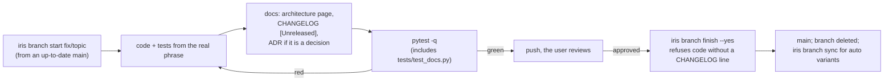

# 14 · Development: CLI, tests, extending, branching

Source: `iris/cli.py`, `iris/doctor.py`, `iris/branches.py`, `tests/`, `setup.sh`. Rules:
[../BRANCHING.md](../BRANCHING.md), [../README.md](../README.md) (docs rules), [ADR-0022](../adr/0022-branching-and-variants.md),
[ADR-0024](../adr/0024-documentation-as-code.md).

## 1. The `iris` command

`~/.local/bin/iris` is a launcher written by `setup.sh` that runs `.venvs/core/bin/python -m iris.cli`.
Global options: `--agent NAME`, `-v`.

| Command | What |
|---|---|
| `talk` | voice conversation (push-to-talk by default; `--vad`, `--ui`, `--wake`, `--headset`, `--engine`, `--mic`, `--silent`, `--no-mic`, `--no-audio`, `--no-tools`, `--no-sleep`, `--ptt`, `--port`, `--no-browser`) |
| `chat` | typed conversation, spoken replies (same options) |
| `ui` | `talk --ui` |
| `eye` | preview the web UI with no models (`--seconds`, `--port`, `--no-browser`) |
| `say TEXT` | speak a sentence with the current voice (`--engine`, `--out file.wav`) |
| `mic` | microphone test (`--list`, `--device`, `--seconds`) |
| `ptt down|up|toggle|interrupt|good|bad|quit` | control a running session (hotkeys) |
| `list` | your lists: `[name] | add TEXT --to L | done ID --note | drop ID | open ID | --all` |
| `requests` | older name for `iris list improvements` |
| `observations` | the reflection's hidden guesses: `promote ID | dismiss ID | --all` |
| `findings` | what the loops noticed: `done ID --note | drop ID | open ID | --area | --all` |
| `session [ID]` | one conversation's timings and flags (`--days`) |
| `dossier` | write `.iris/dossier/` for Claude Code (`--out`, `--days`) |
| `jobs` | `status | pause [--for 2h] | resume | stop | enable | disable | idle [--force]` |
| `ollama` | `status | start | stop | restart | set KEY VALUE | profile MODEL OPTION VALUE | bench` |
| `off` | stop everything IRIS runs (`--pause 2h|forever`) |
| `sleep` | reflect on recent sessions now (`--model`) |
| `night` | run the night loop now (`--only`, `--skip`, `--budget`) |
| `report` | the latest morning report (`--open`, `--print`) |
| `review [ID]`, `approve ID`, `reject ID --why` | proposals |
| `rollback [SHA]` | undo the latest (or given) automatic change |
| `log` | self-store history (`-n`) |
| `rate` | blind A/B listening test between voices |
| `branch` | `status | start TYPE/TOPIC | finish --yes | sync [NAME] | unblock NAME` |
| `status` | what's configured and pending |
| `doctor` | check every part (`--full` loads every model once) |
| `metrics` | metrics from recent traces (`--days`) |
| `evals` | run the eval suite (`--judge`, `--golden`, `--model`) |
| `replay` | the replay benchmark (`--split train|holdout|all`, `--live`, `--only ID`, `--json`, `-V`); `replay split SRC` writes the train and holdout halves; `replay candidates [done|drop ID]` lists turns that went wrong |
| `set knob|model NAME VALUE` | change a setting yourself (committed) |
| `persona list | show [N] | use N | add N --file F` | personas |
| `agent list | new NAME [--persona F]` | agents |
| `init` | create the self store |

`tests/test_docs.py` checks that every subcommand registered in `cli.py` appears in this table.

## 2. Tests

```bash
.venvs/core/bin/python -m pytest -q          # ~300 tests, ~30 s, hermetic
```

`tests/conftest.py` makes every test hermetic: a fresh `IRIS_HOME` and self store per test, `OLLAMA_HOST`
pointing at a closed port, `IRIS_OLLAMA=external`, no systemd, no notifications, `HF_HUB_OFFLINE=1`,
`IRIS_OFFLINE=1`. `FakeLLM` stands in for Ollama (a string or a function of the messages);
`tests/fake_ollama.py` is a fake HTTP Ollama for end-to-end tests.

| File | Covers |
|---|---|
| `test_pipeline.py`, `test_end_to_end.py`, `test_worker.py` | the turn, streaming, TTS worker protocol |
| `test_audio.py`, `test_turns.py` | VAD, Smart Turn, merging, wake word |
| `test_textproc.py`, `test_features.py` | sanitizer, splitter, pronunciation, tools, live voice |
| `test_actions.py`, `test_fastpath.py` | honesty layer, exact answers (incl. a 3000-sum property test) |
| `test_self.py`, `test_loops.py`, `test_local_loop.py` | self store, tiers, tuner, sleep, night, findings |
| `test_session_replay.py` | **real utterances from real sessions** as regression cases |
| `test_branches.py` | the branch workflow with temporary git repos |
| `test_mine.py` | rule mining: proposals, thresholds, candidates, the night stage changes nothing |
| `test_replay.py` | the replay benchmark itself, and that every repo case passes (known failures stay failing until fixed) |
| `test_docs.py` | the documentation stays complete and links stay valid |

Rule: every behaviour fix gets a test built from the real phrase that failed (`test_session_replay.py`).

Model tooling: `scripts/strip_mmproj_audio.py` (a vision-only copy of a multimodal Ollama model, see
[03](03-thinking.md#multimodal-models-drop-what-iris-doesnt-use)).

Diagrams are checked outside the suite (they need Node and a browser): `python scripts/check_diagrams.py`
renders every Mermaid block in the docs and fails on any that GitHub couldn't draw.

### How a change moves through the repo



## 3. Extending

| To add | Do | Then document in |
|---|---|---|
| a voice engine | `iris/tts/engines/<name>.py` with `Engine` (contract in [04](04-speaking.md#6-tts-workers)); `install_<name>` in `setup.sh`; add to `models.tts_engine.choices` in the template; a `DEFAULT_MB` size in `vram.py` | 04, 13, ADR if it becomes a default |
| a tool | `Tool(...)` in `iris/tools/`, register in `tools.registry`, add to `tools.enabled` in the template, tool-choice cases in `evals/tools.yaml`, persona's Tools paragraph | 03 or 05, 13 |
| a deterministic skill / command | see [05 §7](05-commands-and-skills.md#7-adding-a-new-deterministic-skill) | 05, 01 if precedence changes |
| a knob | a one-line entry in the template `pod.yaml` (`sync_knobs` brings it to existing agents); read it with `settings.knob`; a tuner rule if it is `auto` | 13, 08 if tuned |
| a night stage | `s_<name>` method in `Night`, add to `STAGES` (and `IDLE_STAGES` / `NEEDS_LLM` as needed) | 08 |
| a metric | compute it in `metrics.compute`, describe in `DESCRIPTIONS`, a target if it matters | 11 |
| a trace field or event | write it in the producer | 11 (`test_docs.py` checks event names) |
| a file on disk | its owner module | 12 |
| a new module | anything | the module map in 00 (`test_docs.py` enforces it) |
| an LLM backend other than Ollama | implement `stream`, `complete`, `complete_json`, `available` like `iris/llm.py:Ollama` | 03, ADR |

## 4. Branching (summary)

* `main` only receives merges you approved. Improvement branches `fix|feat|docs|chore/<topic>` are cut
  from `main`, **one at a time**, merged `--no-ff`, then deleted: `iris branch start|finish`.
* `variant/<name>` branches are long-lived alternatives registered in `docs/variants.yaml`; `auto`
  variants are kept current with `main` by `iris branch sync`, `manual` ones are left to you.
* `iris branch finish` also refuses to merge code changes that don't update `CHANGELOG.md`.

Full rules: [../BRANCHING.md](../BRANCHING.md).

## 5. `iris doctor`

Checks the self store, core Python modules, IRIS's Ollama (and a stray system-Ollama model holding VRAM),
the daytime and judge models, that the LLM runs mostly on the GPU (Pascal needs CUDA 12 runners), a
reasoning-leak probe, GPU memory for the chosen voice, Whisper models, each voice venv's torch/CUDA
(including sm_61 kernels), the voices themselves (`--full`), audio devices, and the timers. Every FAIL
line says what to run.
