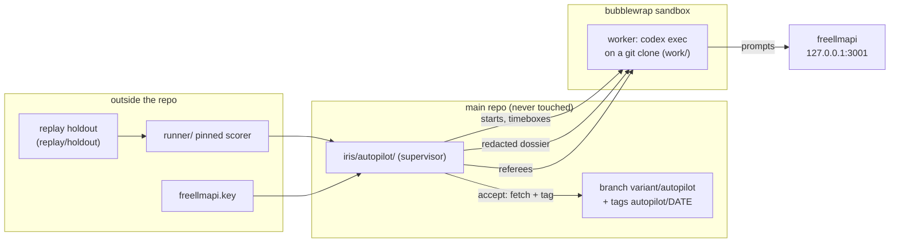
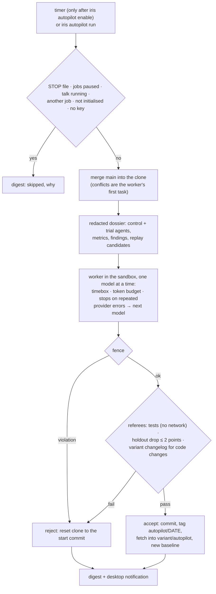

# 15 · The autopilot supervisor

Source: `iris/autopilot/*.py`, `docs/variants.yaml`, `docs/plans/autopilot-variant.md`. Decisions:
[ADR-0028](../adr/0028-proposed-cloud-autopilot-variant.md) (the trial), [ADR-0034](../adr/0034-autopilot-supervisor-and-sandbox.md)
(supervisor, sandbox, referees). Branch rules: [../BRANCHING.md](../BRANCHING.md).

The autopilot lets a strong free-tier model work on IRIS by itself on `variant/autopilot` and keeps only what the frozen
referees accept. The model is a **worker**; everything that can judge, stop or undo it is the **supervisor**, which lives on
`main` where the worker cannot edit it. IRIS's own runtime is unchanged: still local-only.

## 1. Who does what

* **The worker** is the Codex CLI with its own `CODEX_HOME` whose only provider is the local gateway (freellmapi). It reads,
  searches, edits and runs tests like a developer. Your own Codex config is untouched.
* **The clone** `autopilot/work/` is a full git clone (its own `.git`, `origin` = the main repo), not a worktree, so the
  worker cannot reach the main repo's objects or refs through it.
* **The supervisor** is stdlib Python (`iris/autopilot/`), run from `main`. The worker may rewrite the variant's copy of it,
  but the copy that runs is the main one, and any change to `iris/autopilot/` is a fence violation anyway.

## 2. One night

Preemption: starting `iris talk` sends SIGUSR1 to the night; the worker is stopped, the night is judged on what exists
(nothing half-done is accepted without passing the referees), and the GPU is free again.

## 3. The fence

Checked by the supervisor after every run, from the clone's diff against the starting commit (`fence.py`):

| Check | Violation |
|---|---|
| Frozen files | any change under `self_template/evals/golden/`, `iris/autopilot/`, `scripts/autopilot_*`, `docs/variants.yaml` |
| Network | a runtime module (`iris/**`, not tests/scripts) that did not use the network before now does, or a new host that is not loopback or on the allowlist (the existing lookups, search and scout hosts) |
| Secrets | a gateway key, API-key-shaped string or private key in the diff |
| Isolation | the main repo's `HEAD` and the user agent's self store moved during the run |

The holdout cases are outside the repo and are never in the dossier; the pinned scorer in `runner/` (a copy of
`iris/replay.py` with absolute imports) is what produces the number.

## 4. Referees and the commit rule

| Referee | Rule |
|---|---|
| Tests | the clone's whole suite passes, run in the sandbox with no network |
| Holdout | pass rate may drop at most `referees.holdout_drop_points` (2.0) below the baseline |
| Changelog | a night that changes code must add a line to `docs/variants/autopilot/CHANGELOG.md` |

Accepted nights are tagged `autopilot/YYYY-MM-DD` and fetched into the main repo's `variant/autopilot` branch (the only ref
the supervisor writes there). `iris autopilot reset TAG` returns the clone and the branch to any earlier night.

## 5. Privacy and the sandbox

* **Redaction** (`redact.py`): proper nouns taken from the agent's memory facts, the git identity, e-mails, phone numbers,
  addresses, long numbers, URL paths and the home path become stable placeholders (`[person-or-place-1]`). It is
  heuristic, so the first nights' outbound log (`autopilot/log/agent-DATE.jsonl`) should be read by a person. Audio and raw
  transcripts are never sent.
* **Sandbox** (`sandbox.py`): bubblewrap with the system read-only, the home directory replaced by an empty tmpfs, and only
  the clone, a scratch home and the Codex home bound writable. The worker gets the network (the gateway needs it); the
  test run gets none (`--unshare-net`). The worker's own `IRIS_HOME` is a fresh template agent, not the user's memory.
* **Free tiers may train on prompts**, which is why only redacted history and code leave the machine.

## 6. Budget and stopping

`ledger.py` counts tokens and provider errors from the worker's JSON events. A night stops its current model when the token
budget is used or after `budget.stop_after_consecutive_errors` provider errors in a row (rate limits), and the next model of
`models` takes over. `iris autopilot stop` writes the `STOP` file; `pause` pauses all background jobs; the timer exists only
after `iris autopilot enable`. Cost is $0 by construction (no payment method on any gateway account).

## 7. Commands

| Command | What |
|---|---|
| `iris autopilot doctor` | sandbox, Codex, uv, gateway key, catalog size, a code + tool-call probe per configured model, workspace and baseline |
| `iris autopilot init` | create the clone, its layered venv and the pinned scorer; measure the baseline holdout score |
| `iris autopilot run [--force]` | one supervised night now (uses the GPU only if the worker does; stop with `iris off`) |
| `iris autopilot status` | timer, pause, baseline, last seven nights, latest digest |
| `iris autopilot report` | the latest digest |
| `iris autopilot pause` / `resume` / `stop` | pause jobs · resume · write the STOP file |
| `iris autopilot enable` / `disable` | install or remove the nightly systemd user timer (only on the user's say-so) |
| `iris autopilot reset TAG` | return to an earlier accepted night |

## 8. Where things live

Under `$IRIS_HOME/autopilot/` (see [12](12-data-and-files.md)): `config.yaml`, `freellmapi.key`, `state.yaml`, `work/`,
`runner/`, `codex/`, `home/`, `log/`, `digests/`, `STOP`. Settings and defaults: [13](13-configuration-reference.md#6b-autopilot).
