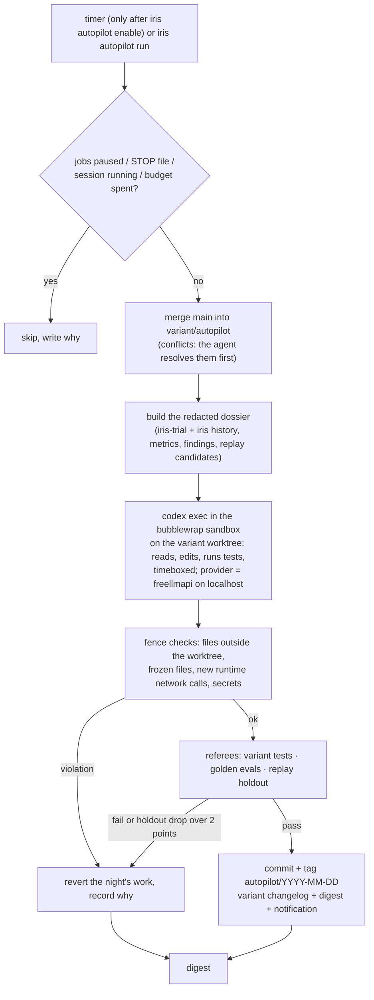

# Plan: the autopilot variant (free-tier frontier models, free control inside a fence)

- **Status:** accepted 2026-10-19 ([ADR-0028](../adr/0028-proposed-cloud-autopilot-variant.md)); being built
- **Runs as:** `variant/autopilot` (mode `auto`, registered in [variants.yaml](../variants.yaml)), agent `iris-trial`
- **Supervisor:** the `iris/autopilot/` package on `main` (the variant's agent cannot edit it); described in [architecture/15](../architecture/15-autopilot.md); the supervisor is built, the first real night is still to run

## The idea

Let strong models on free tiers work on IRIS on their own branch for about two weeks and see where it goes. They may
change **anything** in IRIS on that branch, read redacted conversation history, metrics and findings, and run tests and
benchmarks themselves. What they build must stay a **local-only** assistant. A fixed fence and frozen referees decide what
is kept; the trial decides whether it was worth it.

## Decisions (the user's, 2026-10-18/19)

| Question | Decision |
|---|---|
| Providers | top models from any provider with acceptable terms, through [freellmapi](https://github.com/tashfeenahmed/freellmapi) (self-hosted gateway, one OpenAI-compatible endpoint, failover across ~34 free providers); Cohere (terms forbid personal use) excluded; Google, NVIDIA and Z.ai used with caution (their terms are narrower) |
| Cost | $0: free tiers only, no payment method on any account |
| Chat data | redacted history only; nothing raw leaves the machine |
| Runtime | IRIS stays local-only; the autopilot is development tooling |
| Autonomy | free: any code, tests, docs, prompts, knobs, models, packages (its own venv), `ollama pull` (20 GB budget), night GPU benchmarks; no diff caps, no topic list |
| Judging | replay holdout + golden evals every night, its own tests must pass; then a two-week control-vs-treatment trial |

## The fence (not editable by the agent)

* Only its branch and worktree: never `main`, your agent `iris`, your files, or the system Ollama service.
* No money. No new outbound network in IRIS's runtime code beyond today's web search, lookups and scout.
* Its supervisor, sandbox, budget, stop switch and referees.
* The frozen referees: replay holdout (outside the repo), `evals/golden/`, and the supervisor itself.

The only quality rule on a night's work: the variant's tests pass, golden evals pass, and the replay holdout score does not
drop by more than 2 points. Every accepted night is tagged; `iris autopilot reset <tag>` returns to any earlier state.

## How a night works

## Providers, keys and privacy

* freellmapi runs in Docker on `127.0.0.1:3001` only; the user creates the free keys (Google AI Studio, OpenRouter, Groq,
  Cerebras, Mistral, ...) and pastes them into its dashboard. Keys are encrypted at rest by freellmapi.
* Redaction (in the supervisor) replaces names, places, numbers, e-mails, phone numbers and addresses taken from
  memory facts and a generic pass with placeholders before any dossier text is sent; every outbound prompt is saved to
  `autopilot/log/` for audit. It is heuristic: review the first nights' logs.
* Free tiers may train on prompts. That is why only redacted history and code are sent, never audio or raw transcripts.
* Honest limits: free top models have small daily caps and degrade late in the day; expect a few substantial changes per
  night at most.

## Sandbox

bubblewrap (`bwrap`): system read-only, home hidden except the worktree, the variant's venv, the `iris-trial` agent folder
and read-only model caches; tests run without network; night benchmarks get the GPU devices and localhost for Ollama only.

## Trial and measurement (~2 weeks)

Control = agent `iris` on `main`; treatment = `iris-trial` on the variant. Alternate days using IRIS; `iris autopilot report`
compares `iris session` metrics, `code_handled_rate`, replay scores, and accepted vs rejected nights. Ideas reach `main`
only through normal improvement branches. Success bar chosen up front: replay holdout up, no latency regression,
and nights you would accept.

## Documentation duties

`docs/variants/autopilot/{README.md, CHANGELOG.md, adr/V-NNNN-*.md}` on the variant branch, kept current by the agent
([docs/README.md](../README.md#on-a-variant-branch)); the shared architecture pages on the branch describe the variant as
it becomes; the supervisor's gate runs `tests/test_docs.py` like every other check.
